# Evolutionary Algorithms (Part 1)

The general scheme of an evolutionary algorithm is as follows:
- We need to decide on some (genetic) _encoding_ for our search problem
- The algorithm acts on a _population_ of individuals, initially usually generated randomly
- From that population a strategy of _parent selection_ decides which individuals may reproduce
- Selection is usually influenced by the _fitness_ of individuals
- _Recombination operators_ describe how parents are recombined, thereby merging genetic material from multiple parents
- As part of recombination, _mutation_ on the offspring may occur
- Which of the parents and offspring represent the next generation is determined by a _survivor selection_ strategy
- There needs to be some criterion to decide on _termination_ of the algorithm (e.g., fixed time or number of fitness evaluations)

Historically, there are different branches of evolutionary computation, and the different flavours of evolutionary algorithms have been associated with different data types to represent solutions. For example, _Genetic Algorithms_ are traditionally associated with binary strings, while _Evolution Strategies_ were mainly concerned with real-valued vectors. These differences are largely irrelevant for our purposes. An overall strategy to derive a suitable evolutionary algorithm for a problem at hand is to:
1. Choose a representation that suits the problem at hand
2. Choose variation operators based on that representation
3. Choose selection operators, which are independent of representation


```python
import matplotlib.pyplot as plt
import numpy as np
import random
from sbse_support import seed_everything, Evaluations
seed_everything()
```

We will start by considering the one-max problem again, where a solution is a vector of length _n_, consisting of binary numbers.


```python
n = 100
```

In terms of _genetic encoding_, a _chromosome_ would in this case be the list, each number in the list is a _gene_, and the alleles would be the actual values _0_ and _1_. This _bitstring_ representation also happens to be the classical representation often used for Genetic Algorithms.


```python
def get_random_solution():
    return random.choices([0,1], k=n)
```

Like all metaheuristics, evolutionary algorithms are guided by a fitness function -- in the case of evolutionary algorithms these mainly inform the selection operators about the fitness of candidate individuals. The fitness function is independent of the metaheuristic search algorithm, but specific to the problem we are attempting to solve, so it is the same fitness function we used for local search algorithms when solving the one max problem:


```python
def get_fitness(solution):
    return sum(solution)
```

## Evolution Strategies

Evolution Strategies were developed in the 1960s and 1970s by Ingo Rechenberg and Hans-Paul Schwefel. We will start considering canonical evolution strategies which mainly use selection and mutation.

- Ingo Rechenberg (1971): Evolutionsstrategie – Optimierung technischer Systeme nach Prinzipien der biologischen Evolution (PhD thesis, TU Berlin). Published by Frommann-Holzboog (1973).
- Hans-Paul Schwefel (1975): Evolutionsstrategie und numerische Optimierung (PhD thesis, TU Berlin). Published as Numerische Optimierung von Computer-Modellen mittels der Evolutionsstrategie, Birkhäuser (1977).

Classical evolution strategies were applied to real-valued vectors, where mutation was performed by adding a normally distributed random vector. In our one max example, however, we are optimising a bitvector and not a vector of real numbers. We can define a basic mutation as randomly flipping bits in a chromosome (as is the standard way to mutate bitstrings). An important question here is how many bits to flip in a vector: If the changes are too small, this inhibits the exploration aspect of the algorithm; if the changes are too large, this may inhibit exploitation. A common approach is therefore to make a probabilistic number of changes depending on the length of chromosomes used. Given a vector of length _n_, each element is changed with probability _1/n_. On average, one element will thus be changed. However, it may also happen that more or fewer elements are changed.


```python
def mutate(individual):
    P_mutate = 1/len(individual)
    copy = individual[:]
    for position in range(len(individual)):
        if random.random() < P_mutate:
            copy[position] = 1 - copy[position]
    return copy
```


```python
mutate([0,0,0,0,0,0])
```


    [0, 1, 0, 0, 0, 0]


We use the same bookkeeping as in Random and Local Search: `max_steps` is a budget of fitness evaluations, including initialisation. Each algorithm creates its own `evaluate = Evaluations(get_fitness, max_steps)`. Calling `evaluate(candidate)` returns the score, uses one evaluation, and records the best fitness seen so far. `evaluate.remaining` tells us how much budget is left, and `evaluate.result()` returns `(best, history)`.

The history starts with evaluation 1 and has one entry per evaluation. It records the **best-so-far** score, which may differ from the fitness of the current population, especially with comma selection. Every call counts, even for a repeated bitstring. We retain scores explicitly so that comparing already evaluated individuals does not call the fitness function again. There is no global history to initialise or reset: the caller gives the returned history a name, such as `opo_values`.


```python
max_steps = 1000
```

To start with, we consider the simplest possible evolution strategy which operates on a population of size two: the current point (parent) and the result of its mutation (offspring). The parent selection is therefore easy -- there is only one parent. Survivor selection chooses the mutant as the next parent if its fitness is at least as good as the parent's fitness, otherwise the parent survives and the mutant is disregarded.


```python
def oneplusone():
    evaluate = Evaluations(get_fitness, max_steps)
    current = get_random_solution()
    fitness = evaluate(current)
    while evaluate.remaining:
        candidate = mutate(current)
        score = evaluate(candidate)
        if score >= fitness:
            current, fitness = candidate, score
    return evaluate.result()
```

As in local search, `evaluate.result()` returns the best candidate evaluated and its best-so-far history. For the (1+1)ES, the current parent also has this best fitness, because we only accept offspring whose fitness is at least as good. Keeping the same return format lets us reuse the same experiment and plotting code for all algorithms.


```python
best, opo_values = oneplusone()
print(opo_values[-1])
```

    98


To see the progress of the evolution, we can plot the fitness values again:


```python
plt.plot(range(1, len(opo_values) + 1), opo_values)
plt.xlabel("Fitness evaluations")
plt.ylabel("Best fitness so far")
```


    Text(0, 0.5, 'Best fitness so far')


    
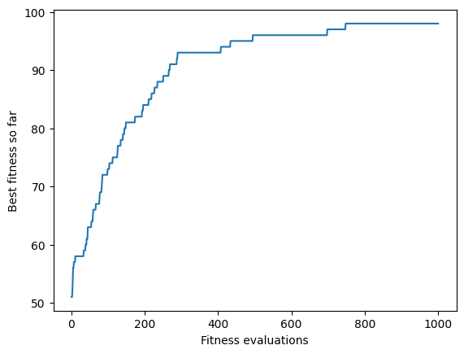
    


The fitness plot is probably slightly less steep than the one we saw for the hillclimber in the last chapter, or at least somewhat more edged. However, this particular evolutionary algorithm is actually a variant of hillclimbing: It is a _randomised_ (or _stochastic_) hillclimber, where the exploration operator chooses random neighbours. As the mutation operator may change more than one bit, however, we may also be making larger jumps in the search space, rather than just considering immediate neighbours.

The name "one plus one" summarises three different parameters of this evolution strategy. First, the number of offspring may differ from the number of parents. In evolution strategies, the _lambda_ parameter typically denotes how many offspring each parent produces. This generalises the (1+1)-ES to a (1+λ)-ES, where the parent produces λ offspring. The survivor selection then considers the parent as well as all mutants, and picks the best of these as the new parent.

For populations, we store each individual together with its evaluated fitness as a pair `(individual, score)`. Initialisation and each new offspring call `evaluate` once; survivor selection sorts these pairs by their stored scores. This makes the evaluation cost visible in the algorithm.


```python
lmbda = 9

def evolution_strategy(mu, offspring_count, plus=True, recombine=False):
    evaluate = Evaluations(get_fitness, max_steps)
    population = []
    for _ in range(min(mu, evaluate.remaining)):
        individual = get_random_solution()
        population.append((individual, evaluate(individual)))
    while evaluate.remaining:
        children = []
        for _ in range(min(offspring_count, evaluate.remaining)):
            parents = random.choices(population, k=2)
            parent = (random.choice(singlepoint_crossover(parents[0][0], parents[1][0]))
                      if recombine else parents[0][0])
            child = mutate(parent)
            children.append((child, evaluate(child)))
        candidates = population + children if plus else children
        population = sorted(candidates, key=lambda entry: entry[1], reverse=True)[:mu]
    return evaluate.result()

def onepluslambda():
    return evolution_strategy(1, lmbda)
```


```python
best, opl_values = onepluslambda()
plt.plot(range(1, len(opo_values) + 1), opo_values, label = "(1+1)ES")
plt.plot(range(1, len(opl_values) + 1), opl_values, label = "(1+λ)ES")
plt.legend()
plt.xlabel("Fitness evaluations")
plt.ylabel("Best fitness so far")
```


    Text(0, 0.5, 'Best fitness so far')


    
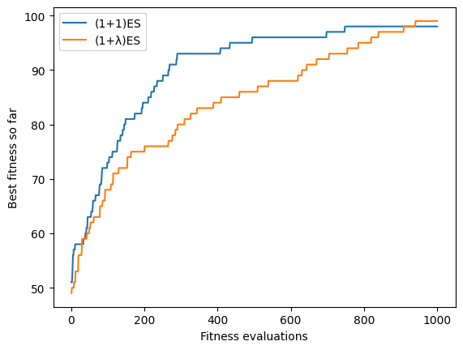
    


Increasing λ leads to more exploration of the local neighbourhood of the current solution; intuitively, the effects will be similar to switching between steepest ascent and first ascent hillclimbers.

The second parameter is the selection strategy, which in the `onepluslambda` strategy is encoded in the name, `plus`, as it considers the parent _plus_ the offspring during selection. An alternative selection is _comma_-selection, where survivors are only selected from the offspring.


```python
def onecommalambda():
    return evolution_strategy(1, lmbda, plus=False)
```


```python
best, ocl_values = onecommalambda()
plt.plot(range(1, len(opo_values) + 1), opo_values, label = "(1+1)ES")
plt.plot(range(1, len(opl_values) + 1), opl_values, label = "(1+λ)ES")
plt.plot(range(1, len(ocl_values) + 1), ocl_values, label = "(1,λ)ES")
plt.legend()
plt.xlabel("Fitness evaluations")
plt.ylabel("Best fitness so far")
```


    Text(0, 0.5, 'Best fitness so far')


    
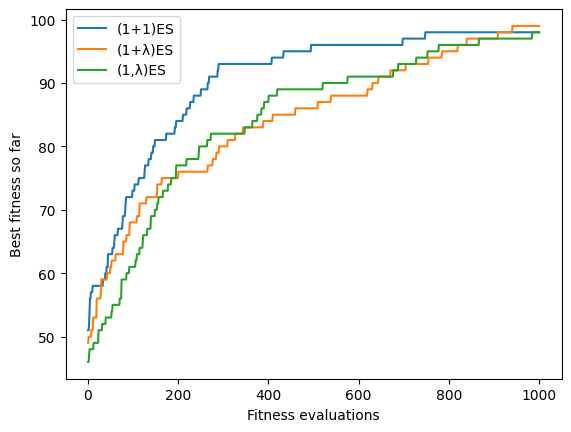
    


We will next generalise our `one-` strategies to larger populations than just one, which represents the third parameter encoded in the name. In evolution strategies, the population size is typically denoted as μ, and we can easily generalise our (1+λ)-ES to a (μ+λ)-ES, where the μ parents produce a total of λ offspring, and then survivor selection considers all parents together with (_plus_) all their offspring.


```python
mu = 3
def mupluslambda():
    return evolution_strategy(mu, lmbda)
```


```python
best, mpl_values = mupluslambda()
plt.plot(range(1, len(opo_values) + 1), opo_values, label = "(1+1)ES")
plt.plot(range(1, len(opl_values) + 1), opl_values, label = "(1+λ)ES")
plt.plot(range(1, len(ocl_values) + 1), ocl_values, label = "(1,λ)ES")
plt.plot(range(1, len(mpl_values) + 1), mpl_values, label = "(μ+λ)ES")
plt.legend()
plt.xlabel("Fitness evaluations")
plt.ylabel("Best fitness so far")
```


    Text(0, 0.5, 'Best fitness so far')


    
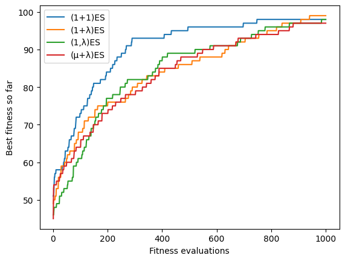
    


The x-axis of these plots counts fitness evaluations, not generations: each curve has exactly `max_steps` points, including the evaluations of the initial population, and the last generation may be cut short when the budget runs out.

For the sake of completeness, let's also consider the (μ,λ)-ES, where the survivor selection only considers the offspring, but not the parents. The (μ,λ)-selection is often preferred in practice because it is better at leaving local optima as well as following moving optima. Note that for (μ,λ) selection μ < λ must hold.


```python
def mucommalambda():
    return evolution_strategy(mu, lmbda, plus=False)
```


```python
best, mcl_values = mucommalambda()
plt.plot(range(1, len(opo_values) + 1), opo_values, label = "(1+1)ES")
plt.plot(range(1, len(opl_values) + 1), opl_values, label = "(1+λ)ES")
plt.plot(range(1, len(ocl_values) + 1), ocl_values, label = "(1,λ)ES")
plt.plot(range(1, len(mpl_values) + 1), mpl_values, label = "(μ+λ)ES")
plt.plot(range(1, len(mcl_values) + 1), mcl_values, label = "(μ,λ)ES")
plt.legend()
plt.xlabel("Fitness evaluations")
plt.ylabel("Best fitness so far")
```


    Text(0, 0.5, 'Best fitness so far')


    
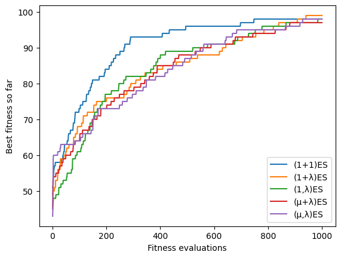
    


The evolution strategies we have considered so far did not include recombination: We simply copied the parents. There is another parameter which we need to consider, and which was hidden from the name so far: The number of individuals involved in recombination ρ. So far, we had implicitly assumed ρ=1, which is known as _cloning_. The parameter is typically included in the name of the evolution strategy using the scheme (μ/ρ,λ). Let's consider the case of ρ=2:


```python
rho = 2
```

For ρ=2 we need an operator that combines two parents into offspring. Crossover takes the genetic material of two or more parent individuals, and recombines them. A basic crossover operator is single-point crossover, where, for two parent chromosomes of length n, we pick a point 0 < x < n, and then take the first x genes from the first parent, and the remaining n - x genes from the second parent. (Allowing x = 0 or x = n would simply copy the parents.) Crossover can be implemented to return a single combined individual, or we can return both variants (and if we only need one, we can randomly choose one).


```python
def singlepoint_crossover(parent1, parent2):
    pos = random.randint(1, len(parent1) - 1)
    offspring1 = parent1[:pos] + parent2[pos:]
    offspring2 = parent2[:pos] + parent1[pos:]
    return offspring1, offspring2
```

Integrating crossover (ρ=2) into our evolution strategies gives us a (μ/2+λ) algorithm:


```python
def mu2pluslambda():
    return evolution_strategy(mu, lmbda, recombine=True)
```


```python
best, m2pl_values = mu2pluslambda()
plt.plot(range(1, len(opo_values) + 1), opo_values, label = "(1+1)ES")
plt.plot(range(1, len(opl_values) + 1), opl_values, label = "(1+λ)ES")
plt.plot(range(1, len(ocl_values) + 1), ocl_values, label = "(1,λ)ES")
plt.plot(range(1, len(mpl_values) + 1), mpl_values, label = "(μ+λ)ES")
plt.plot(range(1, len(mcl_values) + 1), mcl_values, label = "(μ,λ)ES")
plt.plot(range(1, len(m2pl_values) + 1), m2pl_values, label = "(μ/2+λ)ES")
plt.legend()
plt.xlabel("Fitness evaluations")
plt.ylabel("Best fitness so far")
```


    Text(0, 0.5, 'Best fitness so far')


    
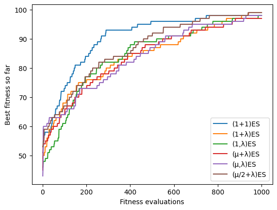
    


Of course we also have a comma-selection variant:


```python
def mu2commalambda():
    return evolution_strategy(mu, lmbda, plus=False, recombine=True)
```


```python
best, m2cl_values = mu2commalambda()
plt.plot(range(1, len(opo_values) + 1), opo_values, label = "(1+1)ES")
plt.plot(range(1, len(opl_values) + 1), opl_values, label = "(1+λ)ES")
plt.plot(range(1, len(ocl_values) + 1), ocl_values, label = "(1,λ)ES")
plt.plot(range(1, len(mpl_values) + 1), mpl_values, label = "(μ+λ)ES")
plt.plot(range(1, len(mcl_values) + 1), mcl_values, label = "(μ,λ)ES")
plt.plot(range(1, len(m2pl_values) + 1), m2pl_values, label = "(μ/2+λ)ES")
plt.plot(range(1, len(m2cl_values) + 1), m2cl_values, label = "(μ/2,λ)ES")
plt.legend()
plt.xlabel("Fitness evaluations")
plt.ylabel("Best fitness so far")
```


    Text(0, 0.5, 'Best fitness so far')


    
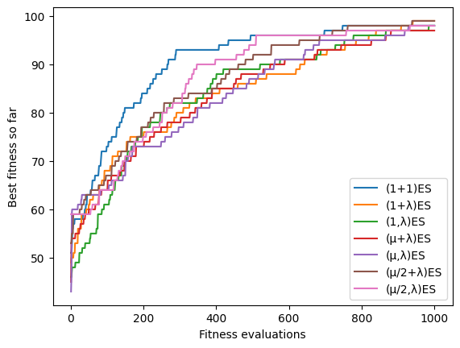
    


An important element of evolution strategies in general we haven't touched upon yet is self-adaptation -- which is a topic we will consider in a later lecture.

## Simple Genetic Algorithm

Traditionally, a main difference between evolution strategies and genetic algorithms is that evolution strategies manipulate the phenotype directly, since they were originally applied to real-valued functions. In contrast, genetic algorithms traditionally act on a genetic encoding (usually binary encoding), and the fitness is evaluated on the decoded phenotype. For our one max example, the difference is rather irrelevant, since our phenotype _is_ a bitstring.

A second major difference lies in where selective pressure is applied. In our evolution strategies, parents are chosen uniformly at random (`random.choices(population, k=2)`), and the deterministic truncation _survivor_ selection (keep the best μ) is what drives the search. In a canonical, simple Genetic Algorithm, _parent_ selection instead is fitness-based and probabilistic, typically applied to larger populations. As a simple first example, we will use tournament selection: For a given number of individuals (the tournament size) we randomly select individuals from the population (with or without replacement), and the best of these individuals wins the tournament, and is a parent for reproduction.


```python
tournament_size = 5

def tournament_selection(population, replacement=False):
    if replacement:
        candidates = random.choices(population, k=tournament_size)
    else:
        candidates = random.sample(population, min(tournament_size, len(population)))
    return max(candidates, key=lambda entry: entry[1])
```

Tournament selection returns an `(individual, score)` pair and compares the stored scores, so selection uses no additional fitness evaluations. Crossover and mutation work on the individuals; only a newly produced offspring is passed to `evaluate`.

The algorithm returns the best evaluated candidate across the run, including when survivor selection is non-elitist. This is distinct from the best member of the final population.

For survivor selection, there are different models: In a _generational_ genetic algorithm, an entire new offspring population is bred, and then replaces the parent population. In a _steady-state_ genetic algorithm, one offspring (or pair of offspring) is generated per generation and one member of population is replaced by that offspring. We will start with a generational genetic algorithm, but include another twist on survivor selection: In _elitism_ a certain share of the best individuals of one generation survives _unchanged_ to the next generation:


```python
def elitism(population):
    population.sort(key=lambda entry: entry[1], reverse=True)
    return population[:elite_size]
```

Before we implement the genetic algorithm, there are a couple of parameters we need to decide on: How large shall the population be? How many of these shall always survive based on elitism? What should the probability for mutation be? While we have avoided the question of the mutation rate by encoding that into the mutation operator, we need to choose sensible values for all other parameters. We will use some common default values:


```python
population_size = 20
elite_size = int(population_size * 0.05)
P_xover = 0.7
selection = tournament_selection
crossover = singlepoint_crossover
```


```python
def ga(trace=None):
    evaluate = Evaluations(get_fitness, max_steps)
    population = []
    for _ in range(min(population_size, evaluate.remaining)):
        individual = get_random_solution()
        population.append((individual, evaluate(individual)))
    if trace:
        trace(evaluate.best, population, evaluate.best_fitness)
    while evaluate.remaining:
        next_population = elitism(population)
        while len(next_population) < population_size and evaluate.remaining:
            parents = selection(population)[0], selection(population)[0]
            children = crossover(*parents) if random.random() < P_xover else parents
            for child in children:
                if len(next_population) == population_size or not evaluate.remaining:
                    break
                child = mutate(child)
                next_population.append((child, evaluate(child)))
        population = next_population
        if trace:
            trace(evaluate.best, population, evaluate.best_fitness)
    return evaluate.result()
```


```python
best, ga_values = ga()
plt.plot(range(1, len(opo_values) + 1), opo_values, label = "(1+1)ES")
plt.plot(range(1, len(opl_values) + 1), opl_values, label = "(1+λ)ES")
plt.plot(range(1, len(ocl_values) + 1), ocl_values, label = "(1,λ)ES")
plt.plot(range(1, len(mpl_values) + 1), mpl_values, label = "(μ+λ)ES")
plt.plot(range(1, len(mcl_values) + 1), mcl_values, label = "(μ,λ)ES")
plt.plot(range(1, len(m2pl_values) + 1), m2pl_values, label = "(μ/2+λ)ES")
plt.plot(range(1, len(m2cl_values) + 1), m2cl_values, label = "(μ/2,λ)ES")
plt.plot(range(1, len(ga_values) + 1), ga_values, label = "GA")
plt.legend()
plt.xlabel("Fitness evaluations")
plt.ylabel("Best fitness so far")
```


    Text(0, 0.5, 'Best fitness so far')


    
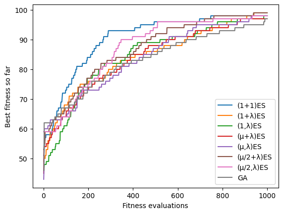
    


### Steady State Genetic Algorithm

Our simple genetic algorithm uses a _generational model_, where each iteration produces a new offspring population. An alternative is a _steady state_ genetic algorithm: In each iteration, we only pick a small number of parents (here 2), produce offspring, and insert each offspring into the population immediately. There are different replacement strategies; for example, the offspring could always replace their parents, or replace a random member. Our implementation below replaces the _worst_ member of the population, but only if the offspring is at least as good as it, so the population's best individual is never lost.


```python
def steadystatega():
    evaluate = Evaluations(get_fitness, max_steps)
    population = []
    for _ in range(min(population_size, evaluate.remaining)):
        individual = get_random_solution()
        population.append((individual, evaluate(individual)))
    while evaluate.remaining:
        parents = selection(population)[0], selection(population)[0]
        children = crossover(*parents) if random.random() < P_xover else parents
        for child in children:
            if not evaluate.remaining:
                break
            child = mutate(child)
            score = evaluate(child)
            worst = min(range(len(population)), key=lambda i: population[i][1])
            if score >= population[worst][1]:
                population[worst] = (child, score)
    return evaluate.result()
```


```python
best, ssga_values = steadystatega()
plt.plot(range(1, len(opo_values) + 1), opo_values, label = "(1+1)ES")
plt.plot(range(1, len(opl_values) + 1), opl_values, label = "(1+λ)ES")
plt.plot(range(1, len(ocl_values) + 1), ocl_values, label = "(1,λ)ES")
plt.plot(range(1, len(mpl_values) + 1), mpl_values, label = "(μ+λ)ES")
plt.plot(range(1, len(mcl_values) + 1), mcl_values, label = "(μ,λ)ES")
plt.plot(range(1, len(m2pl_values) + 1), m2pl_values, label = "(μ/2+λ)ES")
plt.plot(range(1, len(m2cl_values) + 1), m2cl_values, label = "(μ/2,λ)ES")
plt.plot(range(1, len(ga_values) + 1), ga_values, label = "GA")
plt.plot(range(1, len(ssga_values) + 1), ssga_values, label = "SS-GA")
plt.legend()
plt.xlabel("Fitness evaluations")
plt.ylabel("Best fitness so far")
```


    Text(0, 0.5, 'Best fitness so far')


    
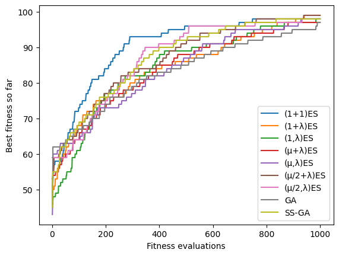
    


## Comparison of the algorithms

We defined a rather large space of possible algorithms and variations, and the usual question is: Which of these works best? The plots above show a single run of each algorithm, which may hint at trends but proves nothing. Let's evaluate the variants over repeated runs.

We reuse `run_all` from Random and Local Search Part 2: it keeps the complete history of every run, so we can compare both final fitness and progress within the budget. Run _i_ of every algorithm starts from the same random seed _i_ (common seeds). Algorithms consume random numbers differently, so the trajectories diverge and we still use independent-sample comparisons. These experiments are cheap, so we use 30 runs.


```python
RUNS = 30

def run_all(searches, repetitions, first_seed=0):
    """Run each search repeatedly; repetition i uses seed first_seed + i."""
    histories = {name: [] for name in searches}
    for i in range(repetitions):
        for name, search in searches.items():
            random.seed(first_seed + i)
            best, history = search()
            histories[name].append(history)
    return histories

def final_fitness(histories):
    return {name: [history[-1] for history in runs] for name, runs in histories.items()}
```

Now we have to call this for each of the algorithms


```python
crossover = singlepoint_crossover
selection = tournament_selection
max_steps = 1000

histories = run_all({"GA"        : ga, 
           "SS-GA"     : steadystatega,
           "(μ/2+λ)ES" : mu2pluslambda,
           "(μ/2,λ)ES" : mu2commalambda,
           "(μ+λ)ES"   : mupluslambda,
           "(μ,λ)ES"   : mucommalambda,
           "(1+1)ES"   : oneplusone, }, RUNS)
results = final_fitness(histories)
from statistics import median
print("Median final fitness over", RUNS, "runs:", {name: median(values) for name, values in results.items()})
```

    Median final fitness over 30 runs: {'GA': 98.0, 'SS-GA': 99.0, '(μ/2+λ)ES': 99.0, '(μ/2,λ)ES': 97.0, '(μ+λ)ES': 97.0, '(μ,λ)ES': 94.0, '(1+1)ES': 99.0}


We can compare the results by plotting the distributions of the final fitness values:


```python
fig, ax = plt.subplots()
ax.boxplot(results.values())
ax.set_xticklabels(results.keys(), rotation=45)
ax.set_ylabel("Final fitness")
plt.tight_layout()
```


    
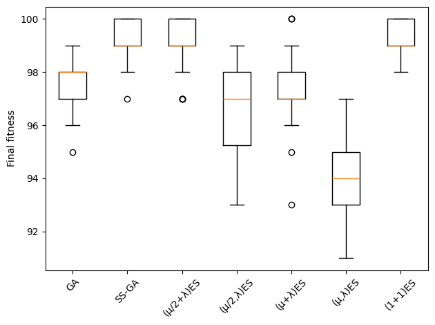
    


If we want to know whether there is a statistical difference between two configurations, we can use the statistics from the previous chapter: a Mann-Whitney U test for significance, with Holm correction because we make several comparisons, and the Vargha-Delaney A12 effect size with a bootstrap confidence interval. A12 > 0.5 means that the first algorithm tends to reach a higher fitness. Let's compare the (1+1)ES with the (μ/2+λ)ES and the GA:


```python
from sbse_support import compare, print_comparison

print_comparison(compare({"(1+1)ES": results["(1+1)ES"],
                          "(μ/2+λ)ES": results["(μ/2+λ)ES"],
                          "GA": results["GA"]}, higher_is_better=True))
```

    comparison                 n        p   Holm p  A12 [95% bootstrap]
    (1+1)ES vs (μ/2+λ)ES   30/30   0.3549   0.3549  0.56 [0.43, 0.70]   not significant
    (1+1)ES vs GA          30/30    1e-09    3e-09  0.95 [0.90, 0.98]   significant
    (μ/2+λ)ES vs GA        30/30    2e-06    4e-06  0.85 [0.75, 0.94]   significant


On this one max instance (n=100, 1000 evaluations), the (1+1)ES and the (μ/2+λ)ES both reach a higher final fitness than the GA over 30 runs; both differences are significant, with large effect sizes (A12 of about 0.95 and 0.85). Between the (1+1)ES and the (μ/2+λ)ES, the test finds no significant difference, and the A12 interval includes 0.5. This does not mean that they perform the same: we simply have no evidence of a difference. We only looked at one particular configuration of search operators for the GA, and varying the parameters and operators may lead to entirely different results. We will look at other operators in a later chapter.

### Progress and time to target

A box plot only describes fitness at the final budget. As in Random and Local Search Part 2, we can also ask how quickly typical runs improve and how reliably they reach a specified target. We reuse the same plotting helpers below. Their x-axis counts **fitness evaluations**, not elapsed seconds or generations: a generation costs different amounts for different algorithms.


```python
def plot_convergence(runs, label):
    """Median history across runs, with an interquartile band around it."""
    length = min(len(h) for h in runs)
    aligned = np.array([h[:length] for h in runs])

    median = np.median(aligned, axis=0)
    lower = np.percentile(aligned, 25, axis=0)
    upper = np.percentile(aligned, 75, axis=0)

    evaluations = range(1, length + 1)
    line, = plt.plot(evaluations, median, label=label)
    plt.fill_between(evaluations, lower, upper, alpha=0.2, color=line.get_color())


def evaluations_to_target(history, target):
    """Number of evaluations before the search first reached `target`.

    Returns None if the target was never reached within the budget.
    """
    for evaluations, fitness in enumerate(history, start=1):
        if fitness >= target:
            return evaluations
    return None

def plot_ecdf(histories, target, budget):
    for name, runs in histories.items():
        lengths = sorted(e for e in (evaluations_to_target(h, target) for h in runs)
                         if e is not None)

        # Step up by 1/repetitions at each observed run length ...
        xs, ys = [1], [0.0]
        for reached, length in enumerate(lengths, start=1):
            xs.append(length)
            ys.append(reached / len(runs))

        # ... and then run flat to the budget, so censored runs stay visible
        xs.append(budget)
        ys.append(ys[-1])
        plt.step(xs, ys, where="post", label=name)

    plt.xscale("log")
    plt.xlim(1, budget)
    plt.ylim(0, 1.02)
    plt.xlabel("Fitness evaluations")
    plt.ylabel("Fraction of runs reaching target")
    plt.title(f"Target fitness {target}")
    plt.legend(loc="upper left", fontsize="small")
```

First, compare three representative evolutionary algorithms. The line is the median best-so-far fitness at each evaluation, and the shading is the 25th–75th percentile range across runs. This IQR describes variation between runs; it is not a confidence interval, and overlapping bands do not replace the tests above.


```python
ea_focus = {name: histories[name] for name in ["(1+1)ES", "(μ/2+λ)ES", "GA"]}
plt.figure(figsize=(8, 5))
for name, runs in ea_focus.items():
    plot_convergence(runs, name)
plt.xscale("log")
plt.xlabel("Fitness evaluations")
plt.ylabel("Best fitness so far")
plt.title(f"One Max: median and IQR of {RUNS} runs")
plt.legend(loc="lower right")
```


    <matplotlib.legend.Legend at 0x13a79fcd0>


    
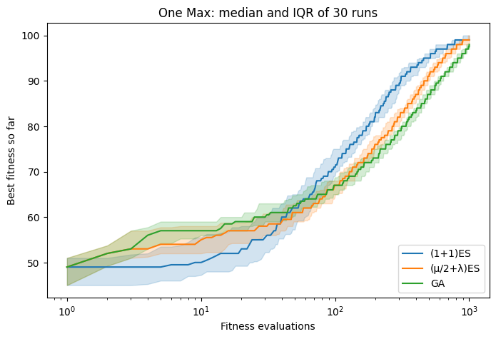
    


The ECDFs show the fraction of runs that have reached a target by each evaluation. We choose two targets before inspecting these curves: fitness 90 (90% of the bits correct) and the optimum 100. Initialisation is evaluation 1. A run that never reaches the target stays in the denominator, so a curve may finish below 1.0. An earlier rise indicates faster attainment; the height at the budget indicates reliability. Conclusions depend on both the target and the budget.


```python
plt.figure(figsize=(11, 4))
plt.subplot(1, 2, 1)
plot_ecdf(ea_focus, 90, max_steps)
plt.subplot(1, 2, 2)
plot_ecdf(ea_focus, n, max_steps)
plt.suptitle("One Max: time to target")
plt.tight_layout()
```


    
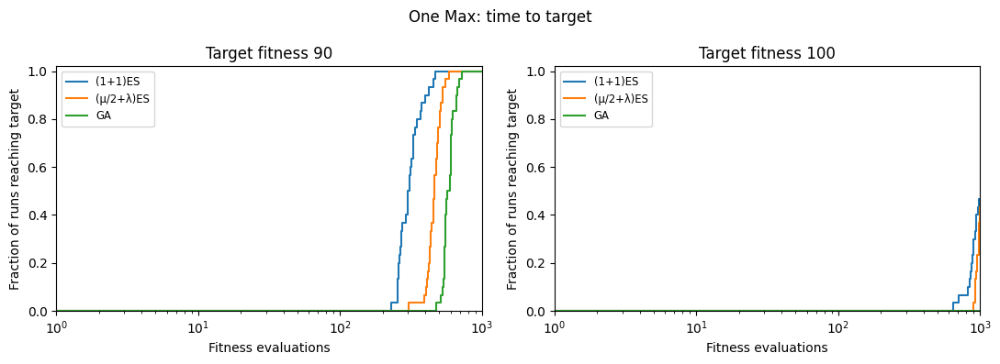
    


In the previous chapter we considered local search algorithms, which appeared to work quite well on the one-max problem. Let's see how they compare against our new global search algorithms.

All local search algorithms required a definition of neighbourhood:


```python
def get_neighbours(candidate):
    neighbours = []
    for pos in range(len(candidate)):
        copy = candidate[:]
        copy[pos] = 1 - copy[pos]
        neighbours.append(copy)
    return neighbours
```

We use **steepest-ascent hillclimbing with random restarts**: evaluate every neighbour, then move to the best one if it strictly improves the current fitness. Shuffling only breaks ties between equally good neighbours; it does not allow early acceptance. This differs from the first-ascent variant, which stops at the first improvement.

As in Random and Local Search, `Evaluations` counts the initial solution, every neighbour scored, and each restart. The algorithm returns `(best, history)`. The final scan stops at the budget: its evaluated candidates still contribute to the best-so-far history, even if the scan is incomplete. We restart only after a complete scan establishes that no improving neighbour exists and budget remains. The optional `restarts` list records the evaluation counts at which restarts occur.


```python
def hillclimbing_steepest_ascent(restarts=None):
    evaluate = Evaluations(get_fitness, max_steps)
    current = get_random_solution()
    fitness = evaluate(current)
    while evaluate.remaining:
        neighbours = get_neighbours(current)
        random.shuffle(neighbours)  # random tie-breaking; we still score every neighbour
        candidate, candidate_fitness = None, float("-inf")
        for neighbour in neighbours:
            if not evaluate.remaining:
                return evaluate.result()  # retain the best evaluated point from a partial scan
            score = evaluate(neighbour)
            if score > candidate_fitness:
                candidate, candidate_fitness = neighbour, score
        if candidate_fitness > fitness:
            current, fitness = candidate, candidate_fitness
        elif evaluate.remaining:
            if restarts is not None:
                restarts.append(len(evaluate.history))
            current = get_random_solution()
            fitness = evaluate(current)
    return evaluate.result()
```

The second local search algorithm was tabu search. It moves to the best non-tabu neighbour even if that is worse, and restarts if every neighbour is tabu:


```python
import math

tabu_size = 50

def tabusearch():
    evaluate = Evaluations(get_fitness, max_steps)
    current = get_random_solution()
    evaluate(current)
    tabu = [current]
    while evaluate.remaining:
        candidate, candidate_fitness = None, -math.inf
        for neighbour in get_neighbours(current):
            if not evaluate.remaining:
                break
            if neighbour in tabu:
                continue
            score = evaluate(neighbour)
            if score > candidate_fitness:
                candidate, candidate_fitness = neighbour, score
        if candidate is None:
            if not evaluate.remaining:
                break
            current = get_random_solution()
            evaluate(current)
            tabu = [current]
        else:
            current = candidate
            tabu = (tabu + [current])[-tabu_size:]
    return evaluate.result()
```

Finally, there is simulated annealing and its helper functions:


```python
import math
def acceptance_probability(fitness, new_fitness, temperature):
    if new_fitness > fitness:
        return 1
    else:
        p = math.exp( (new_fitness - fitness) / temperature)
        return p
```


```python
def temperature(fraction):
    return max(0.01, min(1, 1 - fraction))
```


```python
def simulatedannealing():
    evaluate = Evaluations(get_fitness, max_steps)
    current = get_random_solution()
    fitness = evaluate(current)
    while evaluate.remaining:
        T = temperature(len(evaluate.history) / max_steps)
        candidate = random.choice(get_neighbours(current))
        score = evaluate(candidate)
        if acceptance_probability(fitness, score, T) > random.random():
            current, fitness = candidate, score
    return evaluate.result()
```

We already have the evolutionary algorithms' histories. We extend the experiment with the three local searches, using the same seeds and evaluation budget, and derive the final fitness values from these histories.


```python
histories.update(run_all({
    "HC": hillclimbing_steepest_ascent,
    "Tabu": tabusearch,
    "SA": simulatedannealing,
}, RUNS))
results = final_fitness(histories)
print("Median final fitness over", RUNS, "runs:", {name: median(values) for name, values in results.items()})
```

    Median final fitness over 30 runs: {'GA': 98.0, 'SS-GA': 99.0, '(μ/2+λ)ES': 99.0, '(μ/2,λ)ES': 97.0, '(μ+λ)ES': 97.0, '(μ,λ)ES': 94.0, '(1+1)ES': 99.0, 'HC': 59.0, 'Tabu': 59.0, 'SA': 99.0}


Finally, we are ready to compare local search with our global search algorithms.


```python
fig, ax = plt.subplots()
ax.boxplot(results.values())
ax.set_xticklabels(results.keys(), rotation=45)
ax.set_ylabel("Final fitness")
plt.tight_layout()
```


    
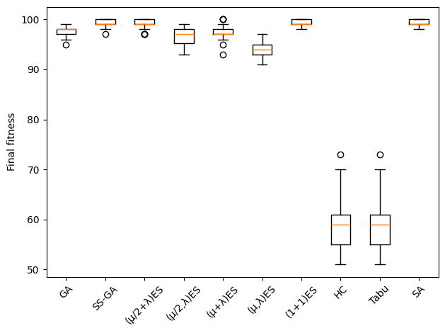
    


Over 30 runs at 1000 evaluations, steepest-ascent HC has median fitness 59, while the GA reaches 98 and (1+1)ES reaches 99.

The cost of a move matters. On 100-bit One Max, steepest-ascent HC scores all 100 neighbours before accepting one improving flip. Every improving neighbour gains exactly one, so the exhaustive scan supplies no better move than first ascent could find. Within 1000 evaluations, HC can make only about ten improvements from an initial score near 50. Tabu search also scans roughly a whole neighbourhood per move, whereas the evolutionary algorithms can propose a new candidate after one evaluation.

This comparison concerns **steepest ascent**, not every form of hillclimbing: shuffled first ascent is much cheaper on One Max. The evaluation budget, neighbourhood and move-selection rule are all part of the algorithm being compared.

The final-fitness comparison hides when progress happens. Use the same two views to compare the GA and (1+1)ES with the three local searches. Keeping five curves makes the IQR bands readable; the box plot above still contains every variant. At the optimum target, an ECDF can also reveal differences hidden by tied final fitness values.


```python
local_focus = {name: histories[name] for name in ["(1+1)ES", "GA", "HC", "Tabu", "SA"]}
plt.figure(figsize=(13, 4))
plt.subplot(1, 3, 1)
for name, runs in local_focus.items():
    plot_convergence(runs, name)
plt.xscale("log")
plt.xlabel("Fitness evaluations")
plt.ylabel("Best fitness so far")
plt.title("One Max: median and IQR")
plt.legend(fontsize="small")
plt.subplot(1, 3, 2)
plot_ecdf(local_focus, 90, max_steps)
plt.subplot(1, 3, 3)
plot_ecdf(local_focus, n, max_steps)
plt.tight_layout()
```


    
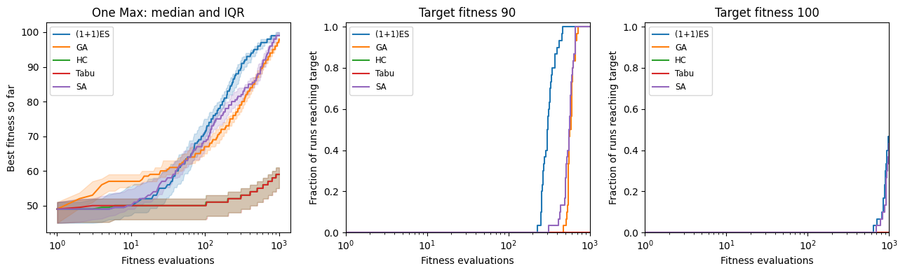
    


## Leading Ones

Let's consider an alternative problem, based on the identical representation and search operators, but with a slightly different fitness function. The Leading Ones problem is a variation of the One Max problem, and often used to study search algorithms. The fitness function for Leading Ones represents the number of leading ones in an individual:


```python
def get_fitness(solution):
    fitness = 0
    for i in solution:
        if i == 1:
            fitness += 1
        else:
            break
    return fitness
```


```python
get_fitness([1,1,1,0,0,0,0,0])
```


    3


```python
get_fitness([1,0,0,1,1,1,1,1])
```


    1


The fitness value can always be increased by appending a single one to the leading
ones, therefore like One Max this is a _unimodal_ problem, i.e., there is only a single local optimum.

Since the fitness function is the only thing that changes, we can immediately run some new experiments to compare our search algorithms:


```python
crossover = singlepoint_crossover
selection = tournament_selection
max_steps = 1000

histories = run_all({"GA"        : ga, 
           "SS-GA"     : steadystatega,
           "(μ/2+λ)ES" : mu2pluslambda,
           "(μ/2,λ)ES" : mu2commalambda,
           "(μ+λ)ES"   : mupluslambda,
           "(μ,λ)ES"   : mucommalambda,
           "(1+1)ES"   : oneplusone,
           "HC"        : hillclimbing_steepest_ascent,
           "Tabu"      : tabusearch,
           "SA"        : simulatedannealing,
          }, RUNS)
results = final_fitness(histories)
print("Median final fitness over", RUNS, "runs:", {name: median(values) for name, values in results.items()})
```

    Median final fitness over 30 runs: {'GA': 18.0, 'SS-GA': 21.5, '(μ/2+λ)ES': 19.5, '(μ/2,λ)ES': 18.5, '(μ+λ)ES': 19.0, '(μ,λ)ES': 16.0, '(1+1)ES': 18.0, 'HC': 22.0, 'Tabu': 22.0, 'SA': 19.0}


```python
fig, ax = plt.subplots()
ax.boxplot(results.values())
ax.set_xticklabels(results.keys(), rotation=45)
ax.set_ylabel("Final fitness")
plt.tight_layout()
```


    
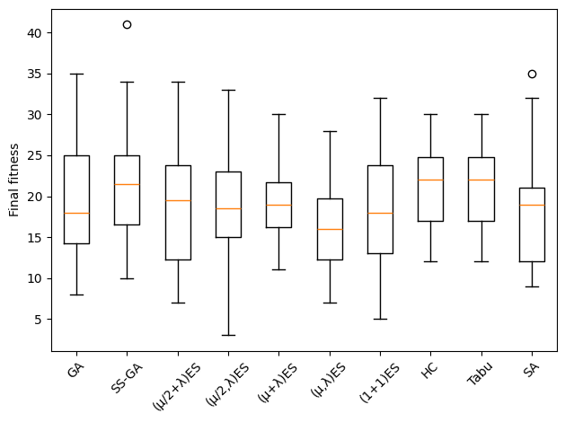
    


On Leading Ones, steepest-ascent HC has median fitness 22, compared with GA 18, SS-GA 21.5 and (1+1)ES 18. It shares the highest median with tabu search (22); this small median advantage over SS-GA alone does not establish a statistically reliable difference. Fitness improves only when the first zero is flipped while the preceding ones stay intact. Steepest ascent spends 100 evaluations scanning the whole neighbourhood per completed move, including its unique improving neighbour; a move can expose several leading ones at once. ES mutation can also disturb the leading ones or change no relevant bit. This gives HC a different cost balance from One Max, but does not guarantee that it beats every evolutionary variant at this budget.

The same views help distinguish slow progress from a low final score. For Leading Ones we use targets 20 and 40 leading ones, fixed for this example rather than an assumption that the optimum will be reached within 1000 evaluations. Compare these curves with One Max: the encoding and operators are unchanged, but their progress depends strongly on the objective.


```python
leading_focus = {name: histories[name] for name in ["(1+1)ES", "GA", "HC", "Tabu", "SA"]}
plt.figure(figsize=(13, 4))
plt.subplot(1, 3, 1)
for name, runs in leading_focus.items():
    plot_convergence(runs, name)
plt.xscale("log")
plt.xlabel("Fitness evaluations")
plt.ylabel("Best fitness so far")
plt.title("Leading Ones: median and IQR")
plt.legend(fontsize="small")
plt.subplot(1, 3, 2)
plot_ecdf(leading_focus, 20, max_steps)
plt.subplot(1, 3, 3)
plot_ecdf(leading_focus, 40, max_steps)
plt.tight_layout()
```


    
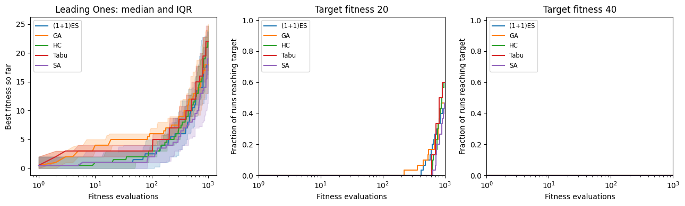
    


### The landscape behind Leading Ones

Both One Max and Leading Ones have only one local optimum under single-bit flips. Why, then, is progress so different? Consider a non-optimal string of length $n$ and fitness $k<n$:

| Single-bit neighbours | One Max | Leading Ones |
|---|---:|---:|
| Improving | $n-k$ | $1$ |
| Neutral | $0$ | $n-k-1$ |
| Worsening | $k$ | $k$ |

For Leading Ones, flipping a bit after the first zero leaves the fitness unchanged; flipping the first zero improves it; flipping any earlier bit makes it worse.

We can check the counts directly at fitness 10 on 100 bits. The suffix can affect the size of an improvement, but not these counts.


```python
leading_ones_fitness = get_fitness  # keep this objective when get_fitness is redefined later

def onemax_fitness(bits):
    return sum(bits)

def neighbour_counts(fitness, solution, neighbours, epsilon=0):
    score = fitness(solution)
    differences = [fitness(other) - score for other in neighbours(solution)]
    return {"improving": sum(delta > epsilon for delta in differences),
            "neutral": sum(abs(delta) <= epsilon for delta in differences),
            "worsening": sum(delta < -epsilon for delta in differences)}

probe_bits = [1] * 10 + [0] * 90
for name, fitness in [("One Max", onemax_fitness), ("Leading Ones", leading_ones_fitness)]:
    print(f"{name:13}", neighbour_counts(fitness, probe_bits, get_neighbours))
```

    One Max       {'improving': 90, 'neutral': 0, 'worsening': 10}
    Leading Ones  {'improving': 1, 'neutral': 89, 'worsening': 10}


At fitness 10, One Max offers 90 improving moves; Leading Ones offers just one, with 89 neutral moves. Unimodality guarantees an improving neighbour exists, but says little about how easy it is to find.

Our ES mutation flips each bit independently with probability $1/n$, rather than flipping exactly one bit. At $k$ leading ones its probability of improvement is exactly

$$\frac{1}{n}\left(1-\frac{1}{n}\right)^k:$$

it must flip the first zero and preserve the leading ones, while changes to the suffix do not matter. For $n=100$, the expected wait for an improvement ranges from 100 evaluations near the start to about 270 near the optimum. Our steepest-ascent HC spends $n$ evaluations per completed neighbourhood scan. That is 100 evaluations per accepted move here, compared with the ES's fitness-dependent waiting time. There is exactly one improving neighbour, so evaluating all the other neighbours does not produce a better improvement. These are costs per improvement, not per added leading one: an improvement can expose several ones at once.

#### Measuring the plateaus

We reuse **neutral fraction** and **lag-1 autocorrelation** from Random and Local Search Part 2. Each unbiased walk starts from a uniformly random bitstring and flips exactly one random bit at each step. We use the same starting string and bit flips for both objectives in each repetition. The traces record the fitness of the visited points, including decreases, rather than the best-so-far histories used to compare algorithms.

These diagnostic evaluations are a separate experiment from the 1000-evaluation search comparisons. Local random generators keep the existing search experiments reproducible.


```python
def autocorrelation(trace, step_size=1):
    if not 0 < step_size < len(trace):
        raise ValueError("Lag must be between 1 and len(trace)-1")
    left, right = np.asarray(trace[:-step_size]), np.asarray(trace[step_size:])
    if np.std(left) == 0 or np.std(right) == 0:
        return float("nan")  # correlation of a constant sequence is undefined
    return float(np.corrcoef(left, right)[0, 1])

def get_fitness_string(trace, epsilon=0):
    return ''.join('+' if b-a > epsilon else '-' if a-b > epsilon else '0'
                   for a, b in zip(trace, trace[1:]))

def neutral_fraction(trace, epsilon=0):
    symbols = get_fitness_string(trace, epsilon)
    return symbols.count('0') / len(symbols) if symbols else 0

def landscape_walk(fitness, start, move, steps=2000):
    """Record raw fitness along a walk; move returns a new solution."""
    current = start[:]
    trace = [fitness(current)]
    for _ in range(steps):
        current = move(current)
        trace.append(fitness(current))
    return trace

def flip_one_bit(bits, rng):
    child = bits[:]
    position = rng.randrange(len(child))
    child[position] = 1 - child[position]
    return child
```


```python
bit_walks = {}
for name, fitness in [("One Max", onemax_fitness), ("Leading Ones", leading_ones_fitness)]:
    bit_walks[name] = []
    for seed in range(RUNS):
        rng = random.Random(10000 + seed)
        start = rng.choices([0, 1], k=100)
        bit_walks[name].append(landscape_walk(fitness, start,
                                              lambda bits: flip_one_bit(bits, rng)))
    traces = bit_walks[name]
    print(f"{name:13}: median neutral fraction {np.median([neutral_fraction(t) for t in traces]):.3f}, "
          f"median autocorrelation {np.median([autocorrelation(t) for t in traces]):.3f}")

fig_walks, axes_walks = plt.subplots(2, 2, figsize=(11, 7), layout="constrained")
for ax, (name, traces) in zip(axes_walks[0], bit_walks.items()):
    ax.plot(traces[0][:401], linewidth=1)
    ax.set(title=f"{name}: one random walk", xlabel="Walk step", ylabel="Visited fitness")
for ax, metric, title in zip(axes_walks[1], [neutral_fraction, autocorrelation],
                            ["Neutral fraction", "Lag-1 autocorrelation"]):
    ax.boxplot([[metric(trace) for trace in traces] for traces in bit_walks.values()])
    ax.set_xticks([1, 2], bit_walks.keys())
    ax.set(title=f"{title}: {RUNS} walks", ylabel=title)
    ax.set_ylim(-0.02, 1.02)
```

    One Max      : median neutral fraction 0.000, median autocorrelation 0.980
    Leading Ones : median neutral fraction 0.980, median autocorrelation 0.971


    
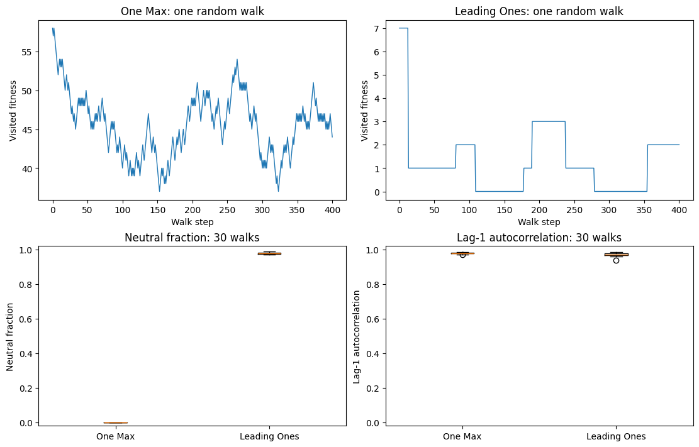
    


One Max has neutral fraction zero: every single-bit flip changes its score. Leading Ones has median neutral fraction 0.98 across these walks: almost every move stays on a plateau. Autocorrelation is high for both, so a large autocorrelation alone does not tell us whether useful improvements are plentiful or rare.

Uniform random strings usually have only a short prefix of ones. These walks therefore mostly describe the low-fitness region, not the whole route to the optimum. The neighbour counts above also show how the local picture changes as fitness increases. The measures depend on the sampling method and move operator: allowing mutations that flip no bits would introduce neutral steps even for One Max.

#### A small landscape we can draw

For six bits we can show all 64 solutions, using the Gray-code layout from Random and Local Search Part 2. The first three bits choose the row and the last three choose the column. Adjacent cells differ in one bit, but the grid cannot display every single-bit neighbour next to its source. Both panels use the same layout and colour scale; the star marks the optimum.

Look for the broad regions of identical colour in Leading Ones. They do not create extra local optima: every non-optimal string still has its one improving neighbour.


```python
gray3 = [value ^ (value >> 1) for value in range(8)]

def six_bits(row, column):
    return [int(bit) for bit in f"{row:03b}{column:03b}"]

fig_bits, axes_bits = plt.subplots(1, 2, figsize=(10, 4.5), layout="constrained")
for ax, (name, fitness) in zip(axes_bits, [("One Max", onemax_fitness),
                                         ("Leading Ones", leading_ones_fitness)]):
    grid = np.array([[fitness(six_bits(row, column)) for column in gray3] for row in gray3])
    image_bits = ax.imshow(grid, origin="lower", cmap="viridis", vmin=0, vmax=6)
    row, column = np.unravel_index(np.argmax(grid), grid.shape)
    ax.plot(column, row, "*", color="red", markeredgecolor="white", markersize=13)
    ax.set_xticks(range(8), [f"{value:03b}" for value in gray3], rotation=45)
    ax.set_yticks(range(8), [f"{value:03b}" for value in gray3])
    ax.set(title=name, xlabel="Last three bits", ylabel="First three bits")
fig_bits.colorbar(image_bits, ax=axes_bits, label="Fitness", ticks=range(7))
```


    <matplotlib.colorbar.Colorbar at 0x13acec5b0>


    
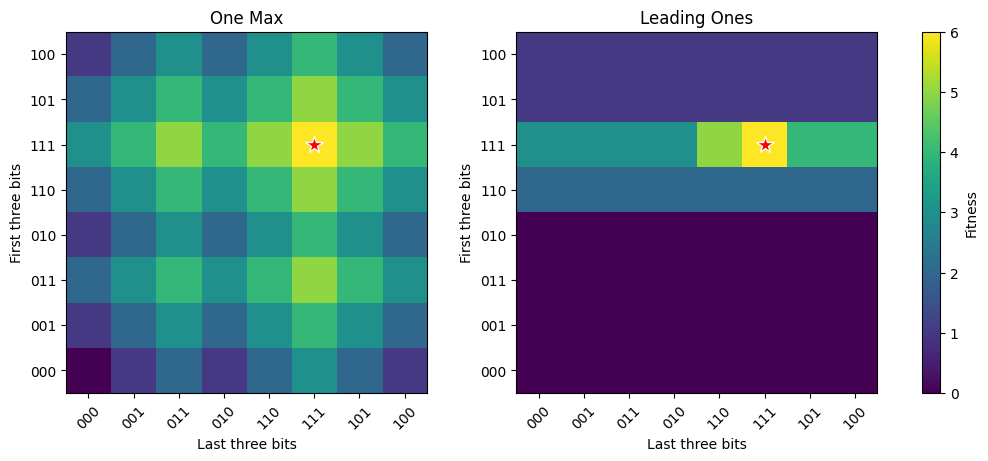
    


## Evolutionary Search on the n-queens problem

As alternative example problem, we will consider the n-queens problem again, which you already know from the previous chapter:


```python
def get_random_solution():
    return [random.randint(0, n-1) for _ in range(n)]
```

To keep the runtimes of the algorithms small, we should reduce the value of `n` compared to what we used for one max:


```python
n = 20
```

The fitness calculation still considers the number of pairs of queens that do not check each other:


```python
def get_fitness(solution):
    fitness = 0
    for i in range(len(solution) - 1):
        for j in range(i + 1, len(solution)):
            if solution[i] != solution[j] \
                and solution[i] != solution[j] + (j - i) \
                and solution[j] != solution[i] + (j - i):
                fitness += 1

    return fitness
```

In order to apply search to a different problem, we also need to make sure that the search operators match the problem encoding. Selection operators are independent of the representation, so we only need to worry about variation operators here. For crossover, we are just cutting and merging lists, so the single-point crossover operator we defined is just fine for the n-queens problem. We will have to change our mutation operator, however, since for one max that simply consists of flipping bits. As a basic mutation operator, we can simply probabilistically replace individual genes with new random values:


```python
def mutate(individual):
    P_mutate = 1/len(individual)
    copy = individual[:]
    for position in range(len(individual)):
        if random.random() < P_mutate:
            copy[position] = random.randint(0, n-1)
    return copy
```

We will also need to redefine the local neighbourhood to make the local search algorithms work: a neighbour moves one queen one row up or down.


```python
def get_neighbours(solution):
    neighbours = []
    for i in range(len(solution)):
        if solution[i] > 0:
            copy = solution[:]
            copy[i] = copy[i] - 1
            neighbours.append(copy)
        if solution[i] < n - 1:
            copy = solution[:]
            copy[i] = copy[i] + 1
            neighbours.append(copy)

    return neighbours
```

Now we can run some experiments using all the different search algorithms defined so far:


```python
max_steps = 1000
tabu_size = 50

histories = run_all({"GA"        : ga, 
           "SS-GA"     : steadystatega,
           "(μ/2+λ)ES" : mu2pluslambda,
           "(μ/2,λ)ES" : mu2commalambda,
           "(μ+λ)ES"   : mupluslambda,
           "(μ,λ)ES"   : mucommalambda,
           "(1+1)ES"   : oneplusone, 
           "HC"        : hillclimbing_steepest_ascent,
           "Tabu"      : tabusearch,
           "SA"        : simulatedannealing
          }, RUNS)
results = final_fitness(histories)
print("Median final fitness over", RUNS, "runs:", {name: median(values) for name, values in results.items()})
```

    Median final fitness over 30 runs: {'GA': 187.0, 'SS-GA': 187.0, '(μ/2+λ)ES': 187.0, '(μ/2,λ)ES': 187.0, '(μ+λ)ES': 187.0, '(μ,λ)ES': 186.0, '(1+1)ES': 187.5, 'HC': 182.0, 'Tabu': 185.0, 'SA': 186.0}


```python
fig, ax = plt.subplots()
ax.boxplot(results.values())
ax.set_xticklabels(results.keys(), rotation=45)
ax.set_ylabel("Final fitness")
plt.tight_layout()
```


    
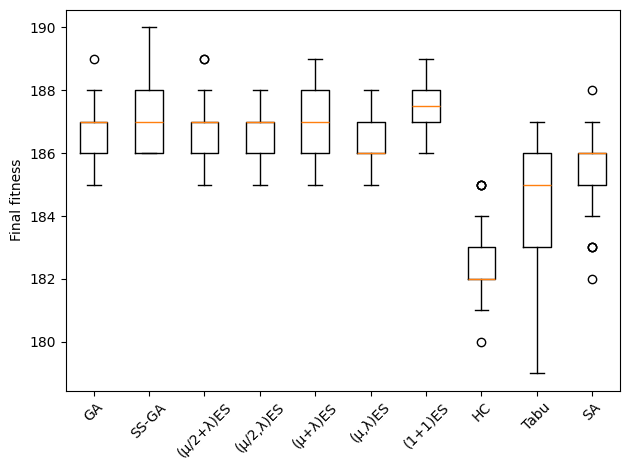
    


On this 20-queens instance, the evolutionary algorithms have medians around 186–187.5, while steepest-ascent HC reaches 182, tabu search 185 and simulated annealing 186 (the optimum is 190 non-attacking pairs). None solves the instance in a typical run within 1000 evaluations. Before claiming reliable differences, we would need the tests and effect sizes from above. The neighbourhood, operators and parameters all influence this ranking; we will examine more alternatives in the next chapter.

## Software Module Clustering

So far we have applied evolutionary search only to abstract toy problems. Let's now turn to a real software engineering task: _software remodularisation_. Large, long-lived software systems tend to erode over time -- new features get bolted on wherever is convenient, and the module structure drifts away from a clean separation of concerns. Given the _module dependency graph_ (MDG) of a system -- which module imports which other module -- the software remodularisation problem asks for a partition of the modules into clusters that is _better_ than the current one: modules within the same cluster should be strongly interdependent (high _cohesion_), while modules in different clusters should depend on each other as little as possible (low _coupling_). This is the classic problem addressed by the Bunch tool of Mancoridis, Mitchell and colleagues, and it is a nice example of a combinatorial SE problem with an enormous, rugged search space -- the number of ways to partition even a few dozen modules is astronomical, so we cannot enumerate all clusterings.

- Spiros Mancoridis, Brian S. Mitchell, Chong Chen, Emden R. Gansner (1999): Bunch: A Clustering Tool for the Recovery and Maintenance of Software System Structures. ICSM.
- Brian S. Mitchell, Spiros Mancoridis (2006): On the Automatic Modularization of Software Systems Using the Bunch Tool. IEEE Transactions on Software Engineering, 32(3).

As our MDG we use the dependency graph of Python's own `email` package from the standard library, extracted statically with the `ast` module (see `data/smc/extract.py`): an edge module_a -> module_b means module_a imports module_b. The package consists of about 20 modules, which gives us a manageable but non-trivial clustering problem. Just as for the n-queens problem, we can represent a clustering as a list of length _n_ (the number of modules), where the value at position _i_ is the id of the cluster that module _i_ is assigned to (an integer between 0 and _n_-1, since in the worst case every module ends up in its own cluster).


```python
def load_mdg(path):
    modules = []
    edges = []
    for line in open(path):
        line = line.strip()
        if line.startswith("# modules:"):
            modules = line.split(":", 1)[1].split()
        elif line and not line.startswith("#"):
            edges.append(tuple(line.split()))
    return modules, edges

modules, mdg_edges = load_mdg("data/smc/email.mdg")
edges = [(modules.index(a), modules.index(b)) for a, b in mdg_edges]
n = len(modules)
n, len(edges)

```


    (19, 44)


Here is the module dependency graph before clustering. Each node is a module in the `email` package; an arrow from A to B means that A imports B. Which modules have many incoming dependencies, and which act as bridges between parts of the package?


```python
from graphviz import Digraph

mdg_plot = Digraph("email_mdg")
mdg_plot.attr(rankdir="LR", size="12,7", labelloc="t",
              label=f"email package: {len(modules)} modules, {len(mdg_edges)} dependencies")
mdg_plot.attr("node", shape="box", style="rounded,filled", fillcolor="aliceblue",
              fontname="Helvetica", fontsize="11")
mdg_plot.attr("edge", color="slategray", arrowsize="0.6")
for module in modules:
    mdg_plot.node(module)
for source, target in mdg_edges:
    mdg_plot.edge(source, target)
mdg_plot
```


    
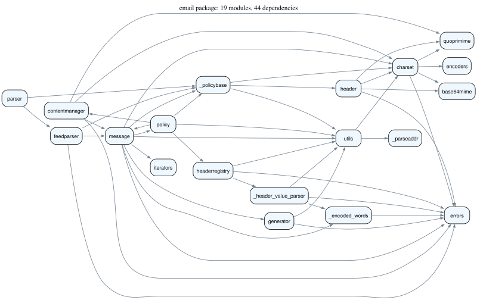
    


```python
def get_random_solution():
    return [random.randint(0, n-1) for _ in range(n)]

```

As fitness function we use _Modularisation Quality_ (MQ) in its TurboMQ variant, one of the MQ measures used by Bunch. For a clustering with clusters $1, \ldots, k$, let $\mu_i$ be the number of _intra-edges_ of cluster $i$ (edges between two modules that are both assigned to cluster $i$), and let $\varepsilon_i$ be the number of _inter-edges_ of cluster $i$ (edges connecting a module in cluster $i$ to a module in a different cluster). Then the modularisation factor of cluster $i$ is:

$$MF_i = \begin{cases} \dfrac{\mu_i}{\mu_i + \frac{1}{2}\varepsilon_i} & \text{if } \mu_i > 0 \\ 0 & \text{if } \mu_i = 0 \end{cases}$$

and the overall fitness is $MQ = \sum_{i=1}^{k} MF_i$: each well-connected, loosely-coupled cluster contributes close to 1, so MQ rewards cohesive, decoupled partitions and is -- like all our fitness functions so far -- to be maximised.


```python
def get_fitness(clustering):
    intra, inter = {}, {}
    for a, b in edges:
        ca, cb = clustering[a], clustering[b]
        if ca == cb:
            intra[ca] = intra.get(ca, 0) + 1
        else:
            inter[ca] = inter.get(ca, 0) + 1
            inter[cb] = inter.get(cb, 0) + 1

    mq = 0
    for c in set(clustering):
        i, e = intra.get(c, 0), inter.get(c, 0)
        if i > 0:
            mq += i / (i + 0.5 * e)
    return mq

```

For crossover we can simply reuse `singlepoint_crossover`, since it works on any list, regardless of what the elements mean. Mutation, however, needs to respect the clustering representation: instead of flipping bits, we move a single, randomly chosen module to a different, randomly chosen cluster (choosing its current cluster again would be a wasted evaluation):


```python
def mutate(individual):
    copy = individual[:]
    pos = random.randint(0, n-1)
    copy[pos] = random.choice([c for c in range(n) if c != copy[pos]])  # always a real move
    return copy

```

We reuse tournament selection and single-point crossover, and the population size and other GA parameters we already settled on. To let the hillclimber operate on clusterings too, we also redefine the neighbourhood: the neighbours of a clustering are all the clusterings obtained by moving a single module to a different cluster.


```python
crossover = singlepoint_crossover
selection = tournament_selection
max_steps = 1000

```


```python
def get_neighbours(candidate):
    neighbours = []
    for pos in range(len(candidate)):
        for c in range(n):
            if c != candidate[pos]:
                copy = candidate[:]
                copy[pos] = c
                neighbours.append(copy)
    return neighbours

```

Let's compare the GA against the steepest-ascent hillclimber (with random restarts) we defined earlier, which relies purely on local search. We start with one run of each:


```python
random.seed(0)
best_hc, hc_values = hillclimbing_steepest_ascent()
best_clustering, ga_values = ga()

plt.plot(range(1, len(hc_values) + 1), hc_values, label="HC")
plt.plot(range(1, len(ga_values) + 1), ga_values, label="GA")
plt.xlabel("fitness evaluations")
plt.ylabel("best MQ")
plt.legend()
```


    <matplotlib.legend.Legend at 0x13ac86a10>


    
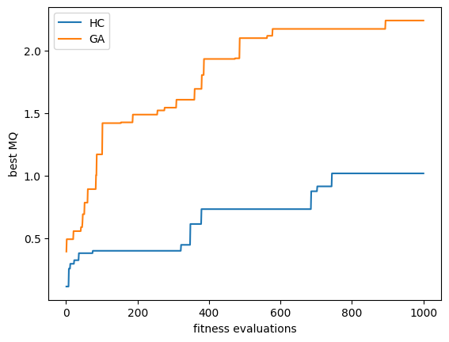
    


A single pair of runs says little. Let's repeat the comparison over 30 runs with common seeds and add two baselines: random search, which any search algorithm should beat, and the mutation-only (1+1)ES from the start of this chapter, which uses the clustering mutation but no population and no crossover. For the hill climber we also count how often it reaches a local optimum and restarts.


```python
def randomsearch():
    evaluate = Evaluations(get_fitness, max_steps)
    while evaluate.remaining:
        evaluate(get_random_solution())
    return evaluate.result()

hc_restarts = []
def hc_counting_restarts():
    log = []
    result = hillclimbing_steepest_ascent(restarts=log)
    hc_restarts.append(len(log))
    return result

clustering_histories = run_all({"Random": randomsearch,
                                "HC": hc_counting_restarts,
                                "(1+1)ES": oneplusone,
                                "GA": ga}, RUNS)
clustering_results = final_fitness(clustering_histories)

print(f"Median MQ over {RUNS} runs ({max_steps} evaluations each):",
      {name: round(median(values), 3) for name, values in clustering_results.items()})
print("HC restarts per run:", sorted(hc_restarts))
plt.boxplot(clustering_results.values())
plt.xticks(range(1, len(clustering_results) + 1), clustering_results.keys())
plt.ylabel("final MQ")
plt.show()
print_comparison(compare(clustering_results, higher_is_better=True,
                         pairs=[("GA", "Random"), ("GA", "HC"), ("(1+1)ES", "HC"), ("GA", "(1+1)ES")]))
```

    Median MQ over 30 runs (1000 evaluations each): {'Random': 1.104, 'HC': 1.122, '(1+1)ES': 2.267, 'GA': 2.175}
    HC restarts per run: [0, 0, 0, 0, 0, 0, 0, 0, 0, 0, 0, 0, 0, 0, 0, 0, 0, 0, 0, 0, 0, 0, 0, 0, 0, 0, 0, 0, 0, 0]


    
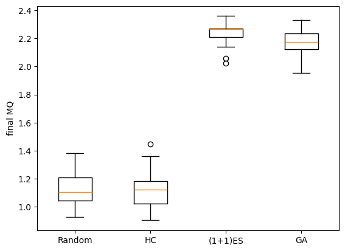
    


    comparison          n        p   Holm p  A12 [95% bootstrap]
    GA vs Random    30/30    3e-11    1e-10  1.00 [1.00, 1.00]   significant
    GA vs HC        30/30    3e-11    1e-10  1.00 [1.00, 1.00]   significant
    (1+1)ES vs HC   30/30    3e-11    1e-10  1.00 [1.00, 1.00]   significant
    GA vs (1+1)ES   30/30   0.0008   0.0008  0.25 [0.13, 0.38]   significant


At 1000 evaluations, the mutation-only (1+1)ES and GA have median MQ 2.267 and 2.175, respectively, while steepest-ascent HC reaches 1.122 and random search 1.104. The comparisons of GA and (1+1)ES against HC show large, significant differences; the GA still scores below (1+1)ES.

Read the repeated comparison above with the cost of a neighbourhood in mind. A clustering of 19 modules has 19 · 18 = 342 labelled one-module moves, and steepest-ascent HC scores all of them before moving. A budget of 1000 evaluations allows only two complete scans and part of a third. Its best-so-far result includes promising candidates encountered in that final partial scan.

A lack of restarts here does not show that HC avoids local optima: the budget may end before it has enough scans to reach one. The GA instead spreads its budget over a population of 20, while (1+1)ES proposes one mutation per evaluation. Compare their distributions, effect sizes and adjusted p-values before ranking them. Crossover still operates on arbitrary cluster labels, so this experiment alone cannot isolate the benefit of recombination.

Finally, let's visualise the best clustering found by the GA run above, colouring modules by the cluster they were assigned to. Cluster ids range from 0 to 18 and carry no meaning, so we first relabel them canonically (0, 1, 2, ... in order of first appearance) and give every cluster its own colour; otherwise two different clusters could end up with the same colour.


```python
palette = ["lightblue", "lightpink", "lightgreen", "khaki", "lightsalmon", "plum", "lightgrey", "orange",
           "turquoise", "wheat", "lightcoral", "palegreen", "lightsteelblue", "peachpuff", "thistle", "gold",
           "aquamarine", "rosybrown", "lightcyan"]   # 19 colours: one per possible cluster

def canonical(clustering):
    """Relabel clusters 0, 1, 2, ... in order of first appearance, so distinct clusters get distinct colours."""
    labels = {}
    return [labels.setdefault(c, len(labels)) for c in clustering]

def cluster_colours(clustering):
    return [palette[c] for c in canonical(clustering)]

dot = Digraph()
for m, colour in zip(modules, cluster_colours(best_clustering)):
    dot.node(m, style = "filled", fillcolor = colour)
for a, b in edges:
    dot.edge(modules[a], modules[b])
print("Clusters in the GA's best clustering:", len(set(best_clustering)))
dot

```

    Clusters in the GA's best clustering: 9


    
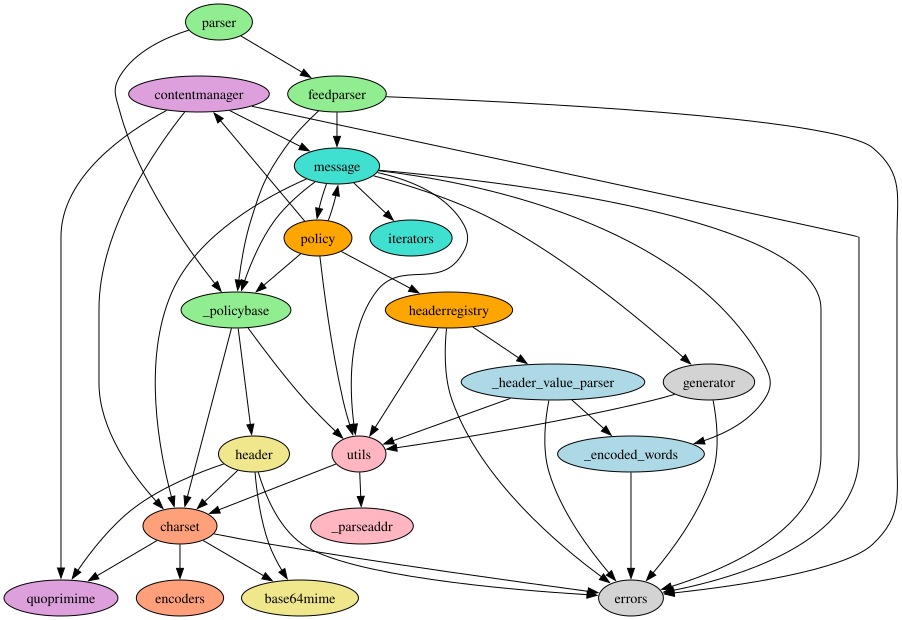
    


### What did the developers choose?

Search gives us the clustering with the best MQ it can find -- but the `email` package already *has* a structure chosen by its developers. The CPython documentation groups these modules into a modern API (`message`, `parser`, `generator`, `policy`, ...), an explicitly labelled *legacy API* (`header`, `charset`, `encoders`, `utils`, `iterators`), and undocumented internal helper modules (the `_`-prefixed modules plus `base64mime`/`quoprimime`). Colouring the graph by this developer-chosen decomposition lets us compare it against the clustering the GA found -- and compute its MQ.


```python
dev_groups = {
    # modern API (documented, current)
    "message": 0, "parser": 0, "feedparser": 0, "generator": 0, "policy": 0,
    "contentmanager": 0, "headerregistry": 0, "errors": 0,
    # legacy API (documented, but labelled legacy)
    "header": 1, "charset": 1, "encoders": 1, "utils": 1, "iterators": 1,
    # internal helpers (undocumented)
    "_encoded_words": 2, "_header_value_parser": 2, "_parseaddr": 2,
    "_policybase": 2, "base64mime": 2, "quoprimime": 2,
}
dev_clustering = [dev_groups[m] for m in modules]
mq_dev = get_fitness(dev_clustering)

dev_dot = Digraph()
for m, colour in zip(modules, cluster_colours(dev_clustering)):
    dev_dot.node(m, style = "filled", fillcolor = colour)
for a, b in edges:
    dev_dot.edge(modules[a], modules[b])

print(f"MQ of the developer-chosen decomposition: {mq_dev:.2f}")
print(f"MQ of the GA's best clustering:           {get_fitness(best_clustering):.2f}")
dev_dot
```

    MQ of the developer-chosen decomposition: 0.94
    MQ of the GA's best clustering:           2.24


    
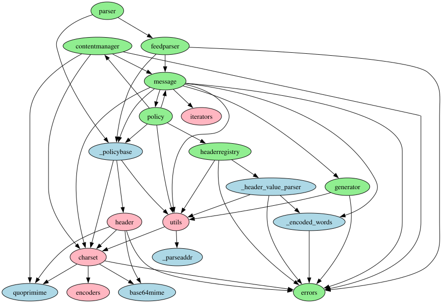
    


The GA run comfortably beats the developers on MQ; in fact, even the median result of random search in the repeated experiment above scores higher than the developers' decomposition. Before concluding that the `email` package should be restructured, remember what MQ actually measures: dependency locality, nothing more. The developers' decomposition optimises for things the fitness function cannot see -- conceptual coherence, API stability, and the history of a backwards-compatible standard library. A higher score on the metric therefore tells us as much about the limits of the metric as about the quality of the architecture. The fitness function is a proxy, and the search will exploit every gap between the proxy and what we actually care about.

### Equivalent partitions and crossover


```python
from sbse_visuals import plot_partition_encodings
plot_partition_encodings()
```


    
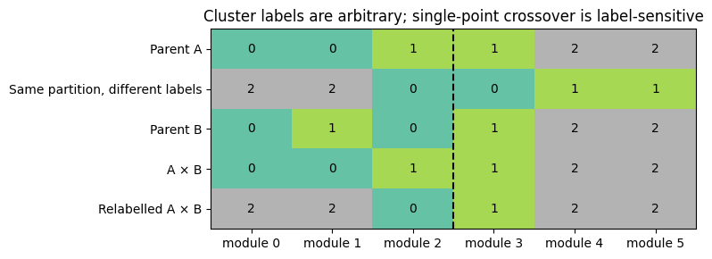
    


The first two rows encode the same grouping of modules. Before looking at the last two rows, predict the offspring of crossing each of them with parent B at the dashed line. Although the two parents are the same partition, the offspring are different partitions: one keeps three clusters of two modules, the other merges modules 0, 1, 4 and 5. Consider canonical labelling or a partition-aware crossover as remedies. Fitness alone cannot correct an operator's representation bias.

### Random vs. Hill Climbing vs. GA

To get a feel for what the search is actually doing, let's render the module graph under three different clusterings side by side: a fresh random assignment, the result of the steepest-ascent hillclimber, and the result of the GA (the single runs from the trace plot above). A random clustering scatters colours with no regard for the edges, while both search algorithms visibly group interdependent modules together. Compare the MQ values in the titles with the repeated experiment: a single run of each algorithm is just one sample from the distributions shown in the box plot.


```python
from io import BytesIO

def render_clustering_png(clustering):
    dot = Digraph()
    for m, colour in zip(modules, cluster_colours(clustering)):
        dot.node(m, style = "filled", fillcolor = colour)
    for a, b in edges:
        dot.edge(modules[a], modules[b])
    return plt.imread(BytesIO(dot.pipe(format = "png")), format = "png")

random.seed(0)                       # the same HC run as in the trace plot above
hc_clustering, _ = hillclimbing_steepest_ascent()
random_clustering = get_random_solution()

mq_random = get_fitness(random_clustering)
mq_hc = get_fitness(hc_clustering)
mq_ga = get_fitness(best_clustering)

fig_cmp, axes_cmp = plt.subplots(1, 3, figsize = (16, 6))
for ax, clustering, title, mq in zip(axes_cmp,
                                      [random_clustering, hc_clustering, best_clustering],
                                      ["Random", "Hill climbing", "GA"],
                                      [mq_random, mq_hc, mq_ga]):
    ax.imshow(render_clustering_png(clustering))
    ax.set_title(f"{title} (MQ = {mq:.2f}, {len(set(clustering))} clusters)")
    ax.axis("off")
plt.tight_layout()
```


    
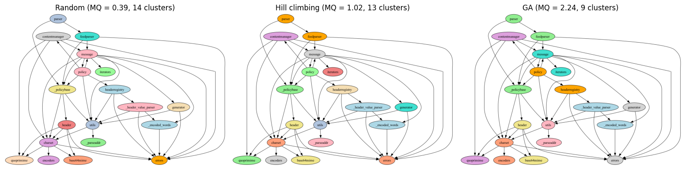
    


### MQ and Cluster Count Over Generations

Since a clustering is just a list of cluster ids with no fixed number of clusters, the GA is free to grow or shrink the number of non-empty clusters as it sees fit -- nothing in the representation forces a particular granularity. Let's rerun the GA and, for each generation, record both the best MQ found so far and the number of non-empty clusters in that best individual, to see whether the search settles on a sensible granularity as a side effect of optimising MQ.

The optional `trace` callback receives the best individual, the scored population, and the best-so-far score after initialisation and each generation (including a final partial generation). Recording this score uses no extra fitness evaluation.


```python
mq_track, k_track = [], []

def record_clustering(best, population, best_fitness):
    mq_track.append(best_fitness)
    k_track.append(len(set(best)))

ga_track_best, ga_track_history = ga(trace=record_clustering)

fig_track, ax_mq = plt.subplots()
ax_mq.plot(mq_track, color = "tab:blue", label = "best MQ")
ax_mq.set_xlabel("generation")
ax_mq.set_ylabel("best MQ", color = "tab:blue")
ax_k = ax_mq.twinx()
ax_k.plot(k_track, color = "tab:orange", label = "# clusters")
ax_k.set_ylabel("number of non-empty clusters", color = "tab:orange")
fig_track.legend(loc = "upper left", bbox_to_anchor = (0.12, 0.88))
```


    <matplotlib.legend.Legend at 0x13ac1a200>


    
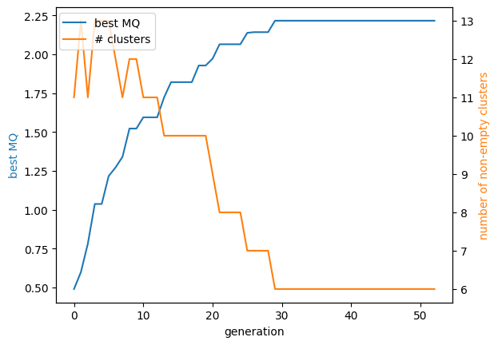
    


## Outlook

The core ideas are representation, variation, parent selection and survivor selection. Plus/comma strategies change survivor eligibility; crossover changes how offspring are constructed. The following chapter compares operators and combines global search with local improvement.

For module clustering, cluster identifiers have no shared semantic meaning across parents. Equivalent partitions can therefore recombine differently. This is a representation-design issue rather than evidence that one crossover is universally best.

In this chapter, we considered some basic variation and selection operators. In the next chapter we will consider a couple of alternatives. Besides all the possible variations in parameters and search operators, there are also many variations of the algorithms themselves. Some specific variants we will consider in later lectures in this course are the following:

- Parallel GAs, in which independent island populations are evolved and sporadically exchange individuals
- Cellular GAs, in which a topology is imposed on the population, and decides on candidates for reproduction
- Memetic Algorithms, which extend GAs with local search
- Adaptive GAs, in which the parameters evolve together with the solutions.

Besides these fundamental variations of the canonical GA, each variant further has many different options. What population size to use? Which selection operator? Which replacement operator? What probabilities to apply the different variation operators? We will consider in a future lecture how to choose these parameters.

