# Random and Local Search (Part 2)

In Part 1 we met random search and hillclimbing, looked at the fitness landscape of the n-queens problem, and tried three ways of escaping local optima: random restarts, tabu search and simulated annealing. This part asks how to compare such randomised algorithms fairly, and how to describe a fitness landscape with numbers when it is too large to draw. It ends with a landscape on which local search fails, which leads to the next chapter.

First we need the problem and the algorithms from Part 1 again. The following cells repeat Part 1's definitions unchanged.

Imports and seeding, as in Part 1.


```python
import matplotlib.pyplot as plt
import random
import math
import numpy as np
from sbse_support import seed_everything, Evaluations
seed_everything()
```

    Matplotlib is building the font cache; this may take a moment.


The n-queens problem: representation, fitness and neighbourhood.


```python
n = 8

def get_random_solution():
    return [random.randint(0, n - 1) for _ in range(n)]


def get_fitness(solution):
    fitness = 0
    for i in range(len(solution) - 1):
        for j in range(i + 1, len(solution)):
            if solution[i] != solution[j] \
                and solution[i] != solution[j] + (j - i) \
                and solution[j] != solution[i] + (j - i):
                fitness += 1

    return fitness


def get_neighbours(solution):
    neighbours = []
    for i in range(len(solution)):
        if solution[i] > 0:
            copy = solution[:]
            copy[i] = copy[i] - 1
            neighbours.append(copy)
        if solution[i] < n - 1:
            copy = solution[:]
            copy[i] = copy[i] + 1
            neighbours.append(copy)

    return neighbours
```

Random search, hillclimbing (first ascent with restarts) and tabu search from Part 1.


```python
def randomsearch():
    best = get_random_solution()
    best_fitness = get_fitness(best)
    history = [best_fitness]
    while len(history) < max_steps:
        candidate = get_random_solution()
        fitness = get_fitness(candidate)
        if fitness > best_fitness:
            best, best_fitness = candidate, fitness
        history.append(best_fitness)
    return best, history


def hillclimbing_first_ascent():
    evaluate = Evaluations(get_fitness, max_steps)
    current = get_random_solution()
    fitness = evaluate(current)
    while evaluate.remaining:
        improved = False
        neighbours = get_neighbours(current)
        random.shuffle(neighbours)   # a fixed scan order would favour the first queens
        for neighbour in neighbours:
            if not evaluate.remaining:
                break
            score = evaluate(neighbour)
            if score > fitness:
                current, fitness, improved = neighbour, score, True
                break
        if not improved and evaluate.remaining:
            current = get_random_solution()
            fitness = evaluate(current)
    return evaluate.result()


tabu_size = 50

def tabusearch():
    evaluate = Evaluations(get_fitness, max_steps)
    current = get_random_solution()
    evaluate(current)
    tabu = [current]
    while evaluate.remaining:
        candidate, candidate_fitness = None, -math.inf
        for neighbour in get_neighbours(current):
            if not evaluate.remaining:
                break
            if neighbour in tabu:
                continue
            score = evaluate(neighbour)
            if score > candidate_fitness:
                candidate, candidate_fitness = neighbour, score
        if candidate is None:
            if not evaluate.remaining:
                break
            current = get_random_solution()
            evaluate(current)
            tabu = [current]
        else:
            current = candidate
            tabu = (tabu + [current])[-tabu_size:]
    return evaluate.result()
```

Simulated annealing from Part 1, with our cooling schedule and the hotter alternative we tried on the slice.


```python
def acceptance_probability(fitness, new_fitness, temperature):
    if new_fitness > fitness:
        return 1
    else:
        p = math.exp( (new_fitness - fitness) / temperature)
        return p


def temperature(fraction):
    return max(0.01, min(1, 1 - fraction))


def simulatedannealing(schedule=None, trace=None):
    evaluate = Evaluations(get_fitness, max_steps)
    current = get_random_solution()
    fitness = evaluate(current)
    schedule = schedule or temperature
    if trace is not None:
        trace.append((fitness, evaluate.best_fitness))
        
    while evaluate.remaining:
        T = schedule(len(evaluate.history) / max_steps)
        candidate = random.choice(get_neighbours(current))
        score = evaluate(candidate)
        if acceptance_probability(fitness, score, T) > random.random():
            current, fitness = candidate, score
        if trace is not None:
            trace.append((fitness, evaluate.best_fitness))
    return evaluate.result()


hotter = lambda fraction: max(0.01, 5 * (1 - fraction))
```

## Comparing Search Algorithms

In order to draw a conclusion whether one randomised algorithm is better than another one, we cannot use individual runs, but need to run each algorithm multiple times, and then statistically check whether the observations result from different distributions.

We compare the final fitness of all four algorithms: random search, hillclimbing (first ascent with restarts), tabu search and simulated annealing.

First, we reconsider our problem instance. On the 8x8 board, the optimum is 28, so final fitness values can only take a handful of values near the top, and many runs end in ties. With larger budgets the better algorithms also increasingly hit the optimum itself. When results saturate like this we have a _ceiling effect_: the problem is too easy to tell the good algorithms apart, and any comparison between them mostly measures how often the weaker one got unlucky. To leave some headroom, we move to a slightly larger board.

We also give every algorithm the same random seed in each repetition, so that repetition `i` of every algorithm starts from the same random state. These _common seeds_ make the experiment reproducible and ensure no algorithm is systematically given luckier random numbers; since the algorithms consume random numbers differently, their runs still diverge immediately, so we analyse the results with tests for independent samples. We use 30 repetitions: these runs are cheap, and with only five runs per algorithm even large differences can fail to reach significance.


```python
n = 12
print(f"Board size {n}x{n}, optimal fitness {n * (n - 1) // 2}")
```

    Board size 12x12, optimal fitness 66


The helper `run_all` runs every search `repetitions` times with common seeds, and keeps the complete history of every run. The final fitness of a run is the last entry of its history.


```python
def run_all(searches, repetitions, first_seed=0):
    """Run each search repeatedly; repetition i of every search uses seed first_seed + i."""
    histories = {name: [] for name in searches}
    for i in range(repetitions):
        for name, search in searches.items():
            random.seed(first_seed + i)
            histories[name].append(search()[1])
    return histories


max_steps = 10000
repetitions = 30
histories = run_all({"Random Search": randomsearch,
                     "Hill Climbing": hillclimbing_first_ascent,
                     "Tabu Search": tabusearch,
                     "Simulated Annealing": simulatedannealing}, repetitions)
final = {name: [history[-1] for history in runs] for name, runs in histories.items()}
```

The experiment gives us thirty final fitness values per algorithm. Printing them is not much help. Before reducing each list to a single number, it is worth looking at the distributions themselves -- a box plot shows the median, the middle half of the runs, and how far the worst and best runs stray:


```python
plt.boxplot(list(final.values()))
plt.xticks(range(1, len(final) + 1), [name.replace(" ", "\n") for name in final])
plt.ylabel("Final fitness")
plt.title(f"{n}-queens, {max_steps} evaluations, {repetitions} runs each")
```


    Text(0.5, 1.0, '12-queens, 10000 evaluations, 30 runs each')


    
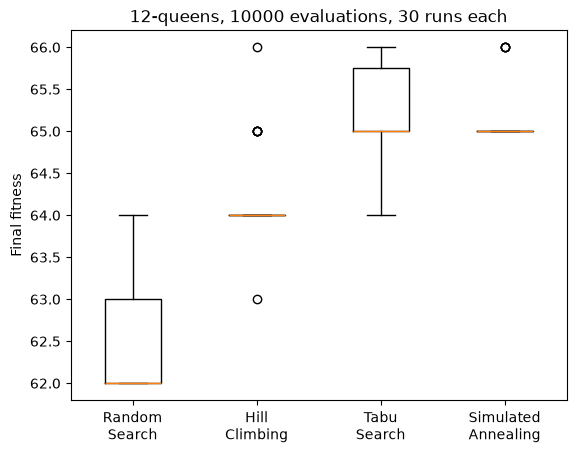
    


Since fitness values are whole numbers, only a handful of different outcomes occur. Counting how many runs end on each value shows the distributions more directly:


```python
def plot_counts(samples):
    """Number of runs ending on each fitness value, one bar per algorithm."""
    values = sorted({value for runs in samples.values() for value in runs})
    width = 0.8 / len(samples)
    for k, (name, runs) in enumerate(samples.items()):
        offset = (k - (len(samples) - 1) / 2) * width
        plt.bar([value + offset for value in values], [runs.count(value) for value in values], width, label=name)
    plt.xticks(values)
    plt.xlabel("Final fitness")
    plt.ylabel("Number of runs")
    plt.legend(fontsize="small")


plot_counts(final)
```


    
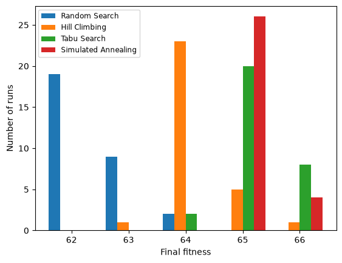
    


Already this says more than a list of numbers would. The distributions are clearly offset: random search ends between 62 and 64, the hillclimber mostly on 64, simulated annealing mostly on 65, and tabu search between 64 and 66. Yet the ranges touch or overlap, and the spread within each algorithm is comparable to the gaps between them -- which is exactly why single runs told us so little.

Is our hillclimber better than random search? Comparing means or medians is not enough: with a different set of seeds, either algorithm could come out ahead by chance. To find out whether there is a real difference, we apply a statistical test. We make no assumption that the data are normally distributed, and therefore use a non-parametric test, the _Mann-Whitney U test_. Its _null hypothesis_ is that neither algorithm tends to produce higher values than the other. The _p-value_ is the probability of seeing a difference at least as large as ours if the null hypothesis were true.


```python
from scipy.stats import mannwhitneyu
mannwhitneyu(final["Random Search"], final["Hill Climbing"]).pvalue
```


    np.float64(4.7511317009629775e-11)


By convention, a p-value lower than 0.05 is usually considered statistically significant (though this is debated). If the p-value is larger, then either there really is no difference, or the difference is so small that more observations (i.e., more repetitions in our experiment) are required in order to detect it. A non-significant result is not evidence that two algorithms are equally good.

Note also that `mannwhitneyu` performs a two-sided test by default, so a small p-value on its own says "these differ", not "the second one is better". The direction and size of the difference come from an effect size.

### Where does the p-value come from?

If the choice of algorithm made no difference, the labels "random search" and "hillclimbing" would be arbitrary. So we pool all 60 runs, shuffle them, split them into two groups of 30, and measure the difference between the groups. Repeating this many times shows which differences chance alone produces.


```python
def shuffled_differences(x, y, shuffles=2000):
    """Differences in mean fitness when the algorithm labels are shuffled."""
    pooled = list(x) + list(y)
    differences = []
    for _ in range(shuffles):
        random.shuffle(pooled)
        differences.append(np.mean(pooled[:len(x)]) - np.mean(pooled[len(x):]))
    return differences
```

We do this for hillclimbing against random search, and for tabu search against simulated annealing. The red line is the difference we actually observed:


```python
def plot_shuffles(x, y, title):
    """Differences between shuffled groups (grey) and the observed difference (red)."""
    differences = shuffled_differences(x, y)
    observed = np.mean(x) - np.mean(y)
    share = np.mean(np.abs(differences) >= abs(observed))
    plt.hist(differences, bins=30, color="lightgrey")
    plt.axvline(observed, color="red")
    plt.title(f"{title}\nshuffles at least as extreme: {share:.3f}")
    plt.xlabel("Difference in mean final fitness")


plt.figure(figsize=(11, 3.5))
for position, (a, b) in enumerate([("Hill Climbing", "Random Search"),
                                   ("Tabu Search", "Simulated Annealing")], start=1):
    plt.subplot(1, 2, position)
    plot_shuffles(final[a], final[b], f"{a} vs {b}")
plt.tight_layout()
```


    
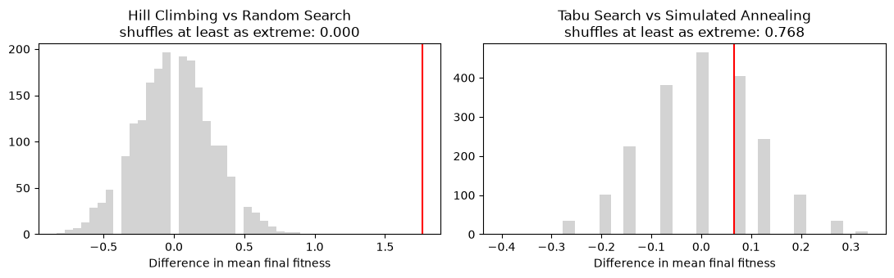
    


The share of shuffles that produce a difference at least as large as the observed one is the p-value of this _permutation test_. For hillclimbing against random search, no shuffle comes anywhere near the observed difference; for tabu search against simulated annealing, chance produces differences like ours all the time. The Mann-Whitney test asks the same question using ranks instead of fitness values, and answers it with a formula instead of by shuffling.

### How many runs do we need?

Would we also have found these differences with fewer runs? We simulate smaller experiments by repeatedly drawing a few of the runs we have, and count how often the test finds the difference.


```python
def detection_rate(x, y, runs, experiments=500):
    """Fraction of simulated experiments with `runs` runs per algorithm where p < 0.05."""
    found = 0
    for _ in range(experiments):
        p = mannwhitneyu(random.choices(x, k=runs), random.choices(y, k=runs)).pvalue
        found += p < 0.05
    return found / experiments
```


```python
run_counts = [3, 5, 10, 20, 30]
for a, b in [("Hill Climbing", "Random Search"), ("Simulated Annealing", "Hill Climbing"),
             ("Tabu Search", "Simulated Annealing")]:
    rates = [detection_rate(final[a], final[b], runs) for runs in run_counts]
    plt.plot(run_counts, rates, marker="o", label=f"{a} vs {b}")
plt.xlabel("Runs per algorithm")
plt.ylabel("Experiments with p < 0.05")
plt.legend(fontsize="small")
```


    <matplotlib.legend.Legend at 0x111a9c8f0>


    
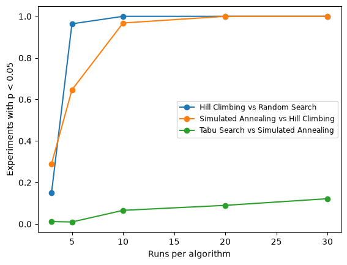
    


Large differences are found reliably once we have ten or so runs, smaller ones need many more. With very few runs even a large difference is often missed, so a non-significant result from a small experiment says very little.

### Significant is not the same as important

The reverse also happens: with enough runs, even a small difference becomes significant. Tabu search and simulated annealing differ only slightly. Suppose we had done many more runs, and they had turned out exactly like the ones we have -- we simulate this by repeating each of our runs several times:


```python
for copies in [1, 4, 16, 64]:
    x = final["Tabu Search"] * copies
    y = final["Simulated Annealing"] * copies
    print(f"{len(x):5d} runs each: p = {mannwhitneyu(x, y).pvalue:.4f}, "
          f"difference in mean fitness = {np.mean(x) - np.mean(y):.2f}")
```

       30 runs each: p = 0.5009, difference in mean fitness = 0.07
      120 runs each: p = 0.1696, difference in mean fitness = 0.07
      480 runs each: p = 0.0059, difference in mean fitness = 0.07
     1920 runs each: p = 0.0000, difference in mean fitness = 0.07


The p-value shrinks as the number of runs grows, but the difference in mean fitness stays at 0.07: it does not get any larger, we only become more certain that it exists. Whether a difference matters is a question the p-value cannot answer. For that we need to measure how large the difference is.

### Effect sizes

A measure of how large a difference is, is called an _effect size_. The difference in means is one, but it depends on the unit of the fitness values and can be dominated by a few unusual runs. There are many alternatives, differing in particular in whether they are standardised (i.e., independent of the measurement unit) or non-parametric (i.e., make no assumptions on the underlying distribution). An example non-parametric effect size is the Vargha-Delaney A12 effect size measurement: Given a performance measure `M` seen in `m` measures of `X` and `n` measures of `Y`, A12 estimates the probability that a run of algorithm `X` yields a higher `M` value than a run of algorithm `Y`, counting ties as half: $A_{12} = P(X > Y) + \frac{1}{2} P(X = Y)$.


```python
from sbse_support import a12
a12(final["Random Search"], final["Hill Climbing"])
```


    0.03277777777777778


A12 compares every run of one algorithm with every run of the other. We can draw all 30 × 30 of these pairings:


```python
def plot_pairings(x, y, x_name, y_name):
    """One cell per pairing of a run of x (row) with a run of y (column): green if x ends higher."""
    grid = np.array([[(a > b) + 0.5 * (a == b) for b in sorted(y)] for a in sorted(x)])
    plt.imshow(grid, cmap="RdYlGn", vmin=0, vmax=1, origin="lower")
    plt.xlabel(f"{y_name} runs (sorted)")
    plt.ylabel(f"{x_name} runs (sorted)")
    plt.title(f"A12 = {grid.mean():.2f}")
```


```python
plt.figure(figsize=(10, 4.5))
plt.subplot(1, 2, 1)
plot_pairings(final["Random Search"], final["Hill Climbing"], "Random search", "Hillclimbing")
plt.subplot(1, 2, 2)
plot_pairings(final["Tabu Search"], final["Simulated Annealing"], "Tabu search", "Simulated annealing")
plt.tight_layout()
```


    
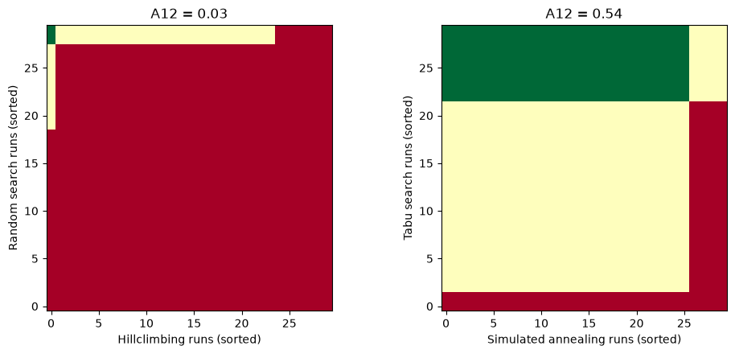
    


Each cell is one pairing: green if the algorithm on the vertical axis ends higher, red if it ends lower, and yellow for a tie. A12 is simply the average colour.

Here A12 is about 0.03: when we pair a random-search run with a hillclimbing run, random search ends higher in only about 3% of the pairings (ties counting half). So the hillclimber is clearly better. An A12 of 0.5 would mean that neither algorithm tends to do better; an A12 of 0 would mean that random search always ends lower, and an A12 of 1 that it always ends higher. A common interpretation is that a big effect is with A12 over 0.71, medium over 0.64, and small over 0.56 (and the same mirrored below 0.5: 0.29, 0.36 and 0.44).

For tabu search against simulated annealing, A12 = 0.54 is below even the threshold for a small effect: the difference that became significant with enough runs is negligible.

### Comparing an algorithm with itself

What does it look like when there is no difference? We run simulated annealing a second time, with different seeds, and compare the two batches.


```python
again = run_all({"Simulated Annealing": simulatedannealing}, repetitions, first_seed=1000)
batches = {"First batch": final["Simulated Annealing"],
           "Second batch": [history[-1] for history in again["Simulated Annealing"]]}

plot_counts(batches)
```


    
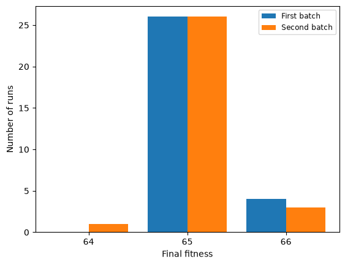
    


The two batches do not look exactly the same. Is the difference significant, and how large is it? We draw the same two pictures as for the real comparisons above:


```python
first, second = batches.values()
plt.figure(figsize=(11, 4))
plt.subplot(1, 2, 1)
plot_shuffles(first, second, "First vs second batch")
plt.subplot(1, 2, 2)
plot_pairings(first, second, "First batch", "Second batch")
plt.tight_layout()
print(f"Mann-Whitney p = {mannwhitneyu(first, second).pvalue:.2f}, A12 = {a12(first, second):.2f}")
```

    Mann-Whitney p = 0.49, A12 = 0.53


    
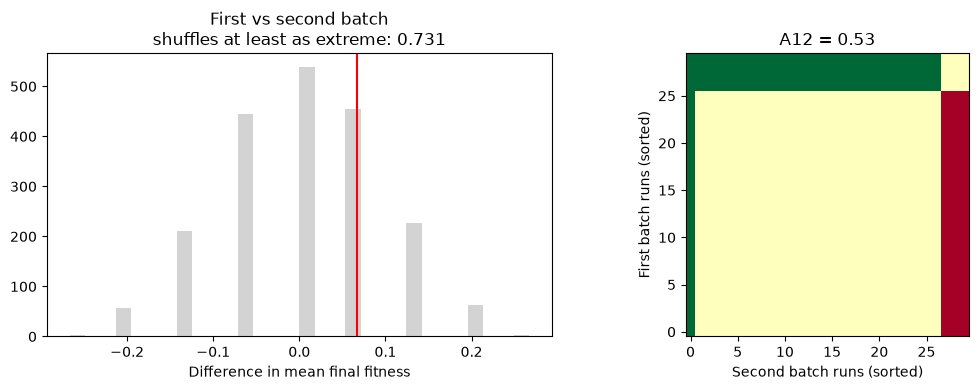
    


The observed difference is one that shuffling produces all the time (in 73% of the shuffles), and the Mann-Whitney test agrees (p = 0.49). Most pairings are ties, and wins and losses roughly balance: A12 = 0.53. This is how much two batches of the same algorithm differ by chance alone; a difference between two algorithms has to be clearly larger than this.

### Correcting for multiple comparisons

So far we have compared individual pairs of algorithms. Four algorithms form six pairs, so to compare all of them we need six tests:


```python
import itertools

pairs = list(itertools.combinations(final, 2))
pvalues = [mannwhitneyu(final[a], final[b]).pvalue for a, b in pairs]
for (a, b), p in zip(pairs, pvalues):
    print(f"{a + ' vs ' + b:38s} p = {p:.2g}")
```

    Random Search vs Hill Climbing         p = 4.8e-11
    Random Search vs Tabu Search           p = 6.1e-12
    Random Search vs Simulated Annealing   p = 1.5e-12
    Hill Climbing vs Tabu Search           p = 4.9e-08
    Hill Climbing vs Simulated Annealing   p = 4.3e-09
    Tabu Search vs Simulated Annealing     p = 0.5


Each of these tests has a 5% chance of a false alarm, a p-value below 0.05 although there is no real difference. With six tests these chances add up: if all six null hypotheses were true and the tests were independent, the probability of at least one false alarm would be $1 - 0.95^6 \approx 26\%$.

We can watch this happen with our two batches of simulated annealing, where we know that there is no real difference. We split the 60 runs into two random halves and test whether the halves differ, six times over, just like our six comparisons. Any difference we find is pure chance. We repeat this for 200 such families of six tests:


```python
annealing_runs = batches["First batch"] + batches["Second batch"]

def random_split_pvalues(runs, tests=6):
    """p-values of `tests` comparisons between two random halves of the same runs."""
    pvalues = []
    for _ in range(tests):
        shuffled = random.sample(runs, len(runs))
        half = len(runs) // 2
        pvalues.append(mannwhitneyu(shuffled[:half], shuffled[half:]).pvalue)
    return pvalues
```


```python
families = [random_split_pvalues(annealing_runs) for _ in range(200)]
false_alarm = np.mean([min(pvalues) < 0.05 for pvalues in families])
print(f"Families of 6 tests with at least one p < 0.05: {false_alarm:.0%}")
```

    Families of 6 tests with at least one p < 0.05: 32%


The standard remedy is to correct for the number of tests in the family. **Holm's correction** is a reasonable default. It sorts the $m$ p-values, compares the smallest against $\alpha/m$, the next against $\alpha/(m-1)$, and so on, stopping at the first comparison that fails. It is uniformly more powerful than the simpler Bonferroni correction and no harder to apply. Equivalently, we can multiply the p-values instead, and keep comparing against 0.05:


```python
def holm(pvalues):
    """Holm-Bonferroni adjusted p-values, returned in the original order."""
    m = len(pvalues)
    adjusted = [0.0] * m
    running = 0.0
    for rank, (position, p) in enumerate(sorted(enumerate(pvalues),
                                                key=lambda pair: pair[1])):
        # The smallest p-value is scaled by m, the next by m - 1, and so on.
        # The running maximum keeps the adjusted values non-decreasing.
        running = max(running, (m - rank) * p)
        adjusted[position] = min(1.0, running)
    return adjusted
```

Applied to the same 200 families of chance comparisons:


```python
corrected = np.mean([min(holm(pvalues)) < 0.05 for pvalues in families])
print(f"Families of 6 tests with at least one p < 0.05: {false_alarm:.0%} uncorrected, {corrected:.0%} with Holm")
```

    Families of 6 tests with at least one p < 0.05: 32% uncorrected, 4% with Holm


Now we apply it to our six comparisons. Later chapters use `compare` from `sbse_support`, which runs every pairwise test, applies the same correction, and adds a bootstrap 95% interval for A12:


```python
from sbse_support import compare, print_comparison

rows = compare(final)
assert [row["p_holm"] for row in rows] == holm(pvalues)
print_comparison(rows)
```

    comparison                                 n        p   Holm p  A12 [95% bootstrap]
    Random Search vs Hill Climbing         30/30    5e-11    2e-10  0.03 [0.00, 0.08]   significant
    Random Search vs Tabu Search           30/30    6e-12    3e-11  0.00 [0.00, 0.01]   significant
    Random Search vs Simulated Annealing   30/30    2e-12    9e-12  0.00 [0.00, 0.00]   significant
    Hill Climbing vs Tabu Search           30/30    5e-08    1e-07  0.12 [0.04, 0.22]   significant
    Hill Climbing vs Simulated Annealing   30/30    4e-09    1e-08  0.10 [0.03, 0.19]   significant
    Tabu Search vs Simulated Annealing     30/30   0.5009   0.5009  0.54 [0.43, 0.65]   not significant


Three things are worth noting about this table.

First, our conclusions survive. All comparisons involving random search or hillclimbing have p-values so small that multiplying them by up to six changes nothing.

Second, the correction mainly affects middling p-values. A p-value of $10^{-8}$ stays negligible however many tests we run, and 0.5 was not significant anyway; but among six tests, a p-value of 0.02 can become 0.12. This matters most for small experiments: with five runs per algorithm, even perfect separation (every run of one algorithm beats every run of the other) gives p = 0.008 at best, which after the correction is at best 0.048 -- and with ties in the fitness values, not significant at all.

Third, the bootstrap interval shows how precisely we know each effect: we resample the runs of each algorithm with replacement many times, and record how much A12 varies. For tabu search against simulated annealing the interval includes 0.5, so the data are compatible with either algorithm being somewhat ahead.

Decide what counts as one family of comparisons *before* looking at the numbers, and correct across the whole family. The single tests earlier in this section are part of this family; their corrected p-values are in the table.

### Back to the cooling schedule

On the slice in Part 1, the hotter schedule looked better. We now check this on the real problem, with the same seeds as the runs of our schedule:


```python
hotter_runs = run_all({"Hotter start": lambda: simulatedannealing(schedule=hotter)}, repetitions)
schedule_final = {"Our schedule": final["Simulated Annealing"],
                  "Hotter start": [history[-1] for history in hotter_runs["Hotter start"]]}

print(f"{n}-queens (optimum {n * (n - 1) // 2}), {max_steps} evaluations, {repetitions} runs each")
print_comparison(compare(schedule_final))
```

    12-queens (optimum 66), 10000 evaluations, 30 runs each
    comparison                         n        p   Holm p  A12 [95% bootstrap]
    Our schedule vs Hotter start   30/30    2e-06    2e-06  0.80 [0.71, 0.88]   significant


On the real problem, the hotter schedule is significantly *worse*: our schedule ends higher in four out of five pairings of runs (A12 = 0.80). The slice has only 900 solutions, so wandering around at a high temperature soon covers most of it. The 12-queens problem has $12^{12}$, almost $9 \times 10^{12}$, solutions, and wandering through these is not much better than a random walk.

A slice shows us *what* a parameter does, but not which value is best for the real problem. We chose all parameters in this chapter (tabu list size, cooling schedule, restarts, neighbourhood) by guesswork; choosing them systematically is the topic of the chapter on parameter tuning and control.

## Looking at Whole Runs

We have compared these algorithms in two ways so far, and both were unsatisfying in the same way. The line plots in Part 1 showed a *single* run of each algorithm, which we know proves nothing. The statistics we have just done used thirty runs, but reduced each one to a single number -- the fitness it happened to end on -- and threw the rest of the run away.

We can do better than either, because `run_all` kept the entire history of every run in `histories`.

### Convergence over many runs

The first thing to do with this is to redraw the comparison plot from Part 1 honestly. Instead of one arbitrary run per algorithm, we take the median across all thirty runs at every point in the search, and shade the range from the 25th to the 75th percentile around it. The line then says what a typical run does, and the band says how much runs vary.


```python
def plot_convergence(runs, label):
    """Median history across runs, with an interquartile band around it."""
    length = min(len(h) for h in runs)
    aligned = np.array([h[:length] for h in runs])

    median = np.median(aligned, axis=0)
    lower = np.percentile(aligned, 25, axis=0)
    upper = np.percentile(aligned, 75, axis=0)

    evaluations = range(1, length + 1)
    line, = plt.plot(evaluations, median, label=label)
    plt.fill_between(evaluations, lower, upper, alpha=0.2, color=line.get_color())


plt.figure(figsize=(8, 5))
for name, runs in histories.items():
    plot_convergence(runs, name)

# A log scale spreads out the early part of the search, where most of the
# improvement happens and where the algorithms differ most.
plt.xscale("log")
plt.xlabel("Fitness evaluations")
plt.ylabel("Best fitness so far")
plt.title(f"Median of {repetitions} runs, with the interquartile range")
plt.legend(loc="lower right")
```


    <matplotlib.legend.Legend at 0x111b46360>


    
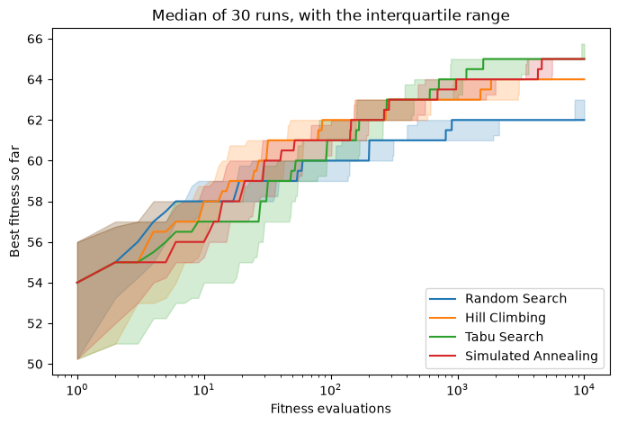
    


The curves show median outcomes and the spread between runs. An IQR band describes the central half of the observed outcomes; it is not a confidence interval. Overlapping bands do not determine whether a statistical test rejects its null hypothesis. Interpret the effect size, distributions and adjusted p-values together.

Early and late orderings may differ, so state the budget at which a conclusion applies. These repetitions describe stochastic variation on this instance, not generalisation to all instances.

### Run-length distributions

An ECDF answers a different question: how many evaluations were needed to reach a chosen target? Initialization is evaluation 1. Runs that never reach the target are censored at the budget and remain in the ECDF denominator.


```python
def evaluations_to_target(history, target):
    """Number of evaluations before the search first reached `target`.

    Returns None if the target was never reached within the budget.
    """
    for evaluations, fitness in enumerate(history, start=1):
        if fitness >= target:
            return evaluations
    return None
```

To see where run lengths come from, here are all 30 runs of hillclimbing, with a dot where each run first reaches a target fitness two below the optimum:


```python
target = n * (n - 1) // 2 - 2
climbing_runs = histories["Hill Climbing"]
for history in climbing_runs:
    plt.plot(range(1, len(history) + 1), history, color="grey", alpha=0.3)
    reached = evaluations_to_target(history, target)
    if reached is not None:
        plt.plot(reached, history[reached - 1], "o", color="red", markersize=4)
plt.axhline(target, color="red", linestyle=":")
plt.xscale("log")
plt.xlabel("Fitness evaluations")
plt.ylabel("Best fitness so far")
```


    Text(0, 0.5, 'Best fitness so far')


    
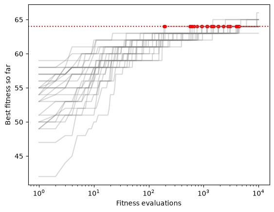
    


Sorting the dots by the number of evaluations, and counting how many runs have reached the target so far, gives the _empirical cumulative distribution function_ (ECDF) of the run length:


```python
lengths = sorted(e for e in (evaluations_to_target(h, target) for h in climbing_runs) if e is not None)
fractions = [k / len(climbing_runs) for k in range(1, len(lengths) + 1)]
plt.step([1] + lengths + [max_steps], [0] + fractions + [fractions[-1] if fractions else 0], where="post")
plt.xscale("log")
plt.ylim(0, 1.02)
plt.xlabel("Fitness evaluations")
plt.ylabel("Fraction of runs reaching target")
```


    Text(0, 0.5, 'Fraction of runs reaching target')


    
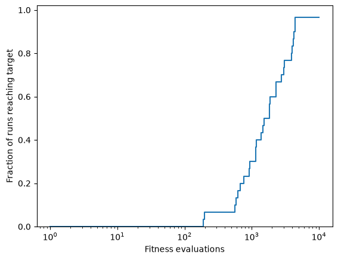
    


Note the `None`: a run that never reaches the target has no run length at all. Such runs are *censored* -- we know only that they would have needed more than the budget we gave them. Discarding them would flatter the algorithm, because we would then be averaging over only its lucky runs. Instead we keep them, and let the ECDF stop below 1.0; the height at which a curve flattens out is then exactly the fraction of runs that reached the target.


```python
def plot_ecdf(histories, target, budget):
    for name, runs in histories.items():
        lengths = sorted(e for e in (evaluations_to_target(h, target) for h in runs)
                         if e is not None)

        # Step up by 1/repetitions at each observed run length ...
        xs, ys = [1], [0.0]
        for reached, length in enumerate(lengths, start=1):
            xs.append(length)
            ys.append(reached / len(runs))

        # ... and then run flat to the budget, so censored runs stay visible
        xs.append(budget)
        ys.append(ys[-1])
        plt.step(xs, ys, where="post", label=name)

    plt.xscale("log")
    plt.xlim(1, budget)
    plt.ylim(0, 1.02)
    plt.xlabel("Fitness evaluations")
    plt.ylabel("Fraction of runs reaching target")
    plt.title(f"Target fitness {target}")
    plt.legend(loc="upper left", fontsize="small")
```


```python
optimum = n * (n - 1) // 2

plt.figure(figsize=(11, 4))
plt.subplot(1, 2, 1)
plot_ecdf(histories, optimum - 2, max_steps)
plt.subplot(1, 2, 2)
plot_ecdf(histories, optimum, max_steps)
plt.tight_layout()
```


    
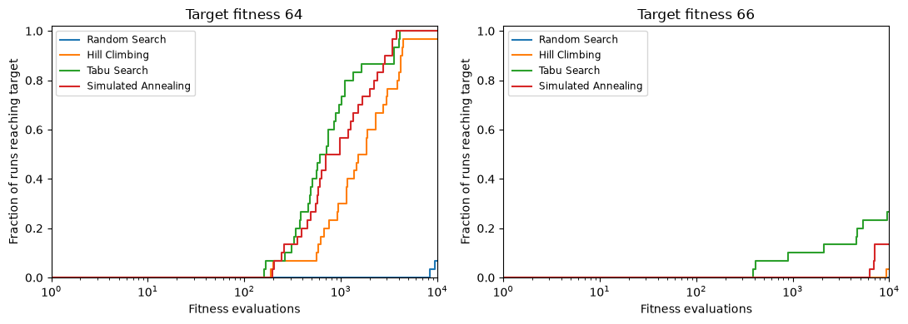
    


On the left, almost every run of hillclimbing, tabu search and simulated annealing reaches fitness 64, so whether a run gets there does not tell these algorithms apart; how fast it gets there does. Half of the tabu search runs reach the target within about 650 evaluations, simulated annealing within about 850, and hillclimbing only within about 1500. Random search reaches it in just two runs, at the very end of the budget.

On the right, no curve gets anywhere near 1. The height at which a curve ends is the share of runs that found the optimum within the budget: about a quarter for tabu search, fewer for simulated annealing and hillclimbing, and none for random search.

If two curves cross, which algorithm is better depends on the budget. On the left, tabu search is ahead of simulated annealing for most of the search, but simulated annealing gets all of its runs to the target slightly earlier. A comparison of final fitness values at a single budget cannot show this.

## Measuring Fitness Landscapes

In Part 1 we could *look* at a fitness landscape, but only because we cut a two-dimensional slice through it. The landscapes our algorithms actually search have far too many dimensions to draw, and the comparisons so far tell us *which* algorithm did better on a problem, but not *why*. Landscape analysis describes what a search encounters, with numbers instead of pictures: how rugged the landscape is, how much of it is flat, and how fitness relates to the distance from an optimum.

For this section we need three things from Part 1 again: the bit-flip neighbourhood (from one max), the general `hillclimbing` that accepts any start, fitness function, neighbourhood and budget, and the compiler-flag data.


```python
def bit_neighbours(candidate):
    neighbours = []
    for pos in range(len(candidate)):
        copy = candidate[:]
        copy[pos] = 1 - copy[pos]
        neighbours.append(copy)
    return neighbours


def hillclimbing(start=None, fitness=None, neighbours=None, budget=None):
    evaluate = Evaluations(fitness or get_fitness, max_steps if budget is None else budget)
    neighbours = neighbours or get_neighbours
    current = get_random_solution() if start is None else list(start)
    score = evaluate(current)
    while evaluate.remaining:
        candidate, candidate_score = current, score
        for neighbour in neighbours(current):
            if not evaluate.remaining:
                break
            value = evaluate(neighbour)
            if value > candidate_score:
                candidate, candidate_score = neighbour, value
        if candidate_score <= score:
            break
        current, score = candidate, candidate_score
    return evaluate.result()


import csv

sizes = {}
with open("data/flags/sizes.csv") as f:
    for row in csv.DictReader(f):
        config = tuple(int(row[f"flag{i + 1}"]) for i in range(8))
        sizes[config] = int(row["size"])

worst_size = max(sizes.values())
```

### A gallery of landscapes

Before measuring landscapes, it helps to know what we are looking for. We draw some made-up landscapes on a grid, like the n-queens slice in Part 1: every cell is a solution, its neighbours are the cells above, below, left and right, and the colour is its fitness.


```python
from scipy.ndimage import gaussian_filter

grid_size = 40
y, x = np.mgrid[0:grid_size, 0:grid_size]

def hill(cx, cy, width, height=1.0):
    return height * np.exp(-((x - cx) ** 2 + (y - cy) ** 2) / (2 * width ** 2))

def random_landscape(smoothness, seed=3):
    """Random values, smoothed: the lower the smoothness, the more rugged."""
    noise = np.random.default_rng(seed).normal(size=(grid_size, grid_size))
    field = gaussian_filter(noise, smoothness, mode="wrap")
    return (field - field.min()) / (field.max() - field.min())
```


```python
gallery = {
    "Smooth": hill(26, 22, 10),
    "Smoothness 6": random_landscape(6),
    "Smoothness 3": random_landscape(3),
    "Rugged": random_landscape(1),
    "Plateaus": np.floor(hill(26, 22, 12) * 5) / 5,
    "Deceptive": np.maximum(hill(10, 28, 9, 0.8), hill(32, 8, 1.2)),
    "Needle in a haystack": ((x == 30) & (y == 10)).astype(float),
    "Two funnels": np.maximum(hill(12, 12, 6, 0.95), hill(30, 30, 6)),
}
```

To draw a landscape we also mark its local optima: white for local optima, red for the global optimum.


```python
def grid_neighbours(cell):
    r, c = cell
    return [(r + dr, c + dc) for dr, dc in [(1, 0), (-1, 0), (0, 1), (0, -1)]
            if 0 <= r + dr < grid_size and 0 <= c + dc < grid_size]

def local_optima(grid):
    """Cells whose neighbours are all strictly worse."""
    return [(r, c) for r in range(grid_size) for c in range(grid_size)
            if all(grid[n] < grid[r, c] for n in grid_neighbours((r, c)))]

def show_landscape(grid, title):
    plt.imshow(grid, cmap="viridis", origin="lower", interpolation="nearest")
    optima = local_optima(grid)
    for r, c in optima:
        plt.plot(c, r, "o", markersize=5, markeredgecolor="black",
                 color="red" if grid[r, c] == grid.max() else "white")
    plt.title(f"{title}\n{len(optima)} local optim{'um' if len(optima) == 1 else 'a'}", fontsize=10)
    plt.xticks([])
    plt.yticks([])
```


```python
plt.figure(figsize=(16, 9))
for position, (name, grid) in enumerate(gallery.items(), start=1):
    plt.subplot(2, 4, position)
    show_landscape(grid, name)
plt.tight_layout()
```


    
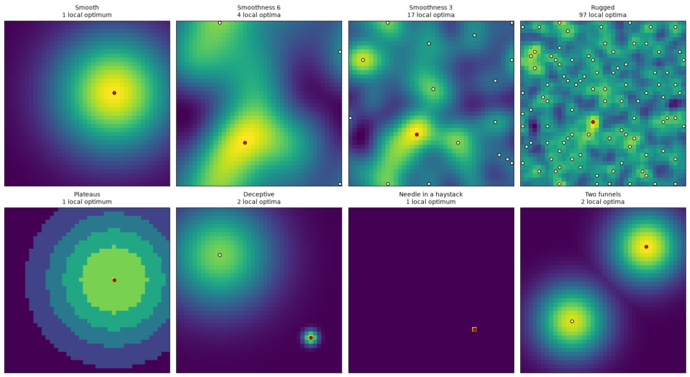
    


Each picture shows one property of a landscape:

- **Smooth:** a single hill. Every step uphill leads to the global optimum, so the landscape is _unimodal_.
- **Smoothness 6, 3 and rugged:** the same random landscape, smoothed less and less. The rougher it is, the more local optima it has (_multimodal_), and the less the fitness of a cell tells us about its neighbours.
- **Plateaus:** large areas of equal fitness (_neutrality_). On a plateau, no neighbour is better, so a hillclimber has no direction to follow.
- **Deceptive:** a broad hill leads away from the global optimum, which is a narrow peak elsewhere. Following the slope is exactly the wrong thing to do.
- **Needle in a haystack:** completely flat apart from a single solution. There is no information to follow at all, and no search can do better than random sampling.
- **Two funnels:** two good regions far apart. A search that settles into one funnel never sees the other.

### What makes a landscape hard?

We give a hillclimber with random restarts the same budget on every landscape, and count how often it finds the global optimum:


```python
def restart_climb(grid, budget):
    """Steepest-ascent hillclimbing with random restarts; True if it finds the global optimum."""
    random_cell = lambda: (random.randrange(grid_size), random.randrange(grid_size))
    current, evaluations = random_cell(), 1
    while evaluations < budget and grid[current] < grid.max():
        neighbours = grid_neighbours(current)
        evaluations += len(neighbours)
        best = max(neighbours, key=lambda n: grid[n])
        if grid[best] > grid[current]:
            current = best
        else:
            current, evaluations = random_cell(), evaluations + 1
    return grid[current] == grid.max()
```


```python
budget, runs = 200, 200
success = {name: np.mean([restart_climb(grid, budget) for _ in range(runs)])
           for name, grid in gallery.items()}
plt.figure(figsize=(8, 4))
plt.barh(list(success)[::-1], list(success.values())[::-1])
plt.xlabel(f"Runs finding the global optimum ({budget} evaluations)")
plt.xlim(0, 1)
plt.tight_layout()
```


    
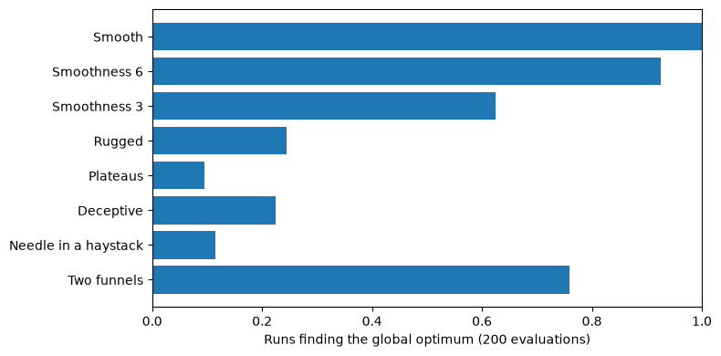
    


On the smooth landscape every run succeeds, and the more rugged the landscape, the more climbs end on the wrong peak. On the deceptive landscape most climbs end on the broad hill. Plateaus and the needle are hardest: hillclimbing stops as soon as no neighbour is strictly better, so the landscape gives it no help at all. The two funnels are mostly found because the restarts try both.

### Basins of attraction

Where steepest-ascent hillclimbing ends up depends only on where it starts. Colouring every cell by the local optimum it leads to shows the _basins of attraction_. From grey cells the climb stops on a flat area without reaching a local optimum. The red line encloses all cells from which the climb reaches the global optimum:


```python
from matplotlib.colors import ListedColormap

def climb_end(grid, cell):
    """Where steepest-ascent hillclimbing from `cell` stops."""
    while True:
        best = max(grid_neighbours(cell), key=lambda n: grid[n])
        if grid[best] <= grid[cell]:
            return cell
        cell = best

def show_basins(grid, title):
    ends = [[climb_end(grid, (r, c)) for c in range(grid_size)] for r in range(grid_size)]
    optima = local_optima(grid)
    regions = np.array([[optima.index(end) % 18 if end in optima else -1 for end in row] for row in ends])
    colours = ListedColormap([c for i, c in enumerate(plt.get_cmap("tab20").colors) if i not in (6, 7)])
    colours.set_bad("lightgrey")   # no red: red marks the global optimum's basin
    plt.imshow(np.ma.masked_less(regions, 0), cmap=colours, vmin=0, vmax=17,
               origin="lower", interpolation="nearest")
    found = np.array([[grid[end] == grid.max() for end in row] for row in ends])
    if 0 < found.mean() < 1:
        plt.contour(found.astype(float), levels=[0.5], colors="red", linewidths=2)
    plt.title(f"{title}\n{found.mean():.0%} of starts reach the global optimum", fontsize=10)
    plt.xticks([])
    plt.yticks([])
```


```python
plt.figure(figsize=(16, 9))
for position, (name, grid) in enumerate(gallery.items(), start=1):
    plt.subplot(2, 4, position)
    show_basins(grid, name)
plt.tight_layout()
```


    
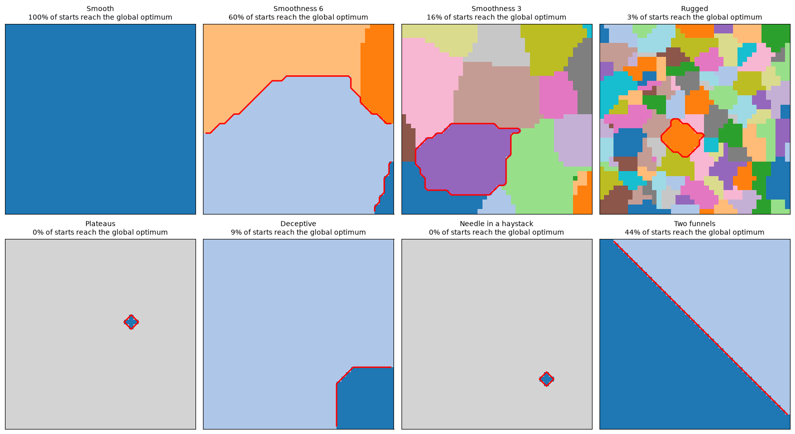
    


Since every restart begins in a random cell, the chance that a single climb finds the global optimum is the share of the landscape inside the red line. This explains the success rates above. The more rugged the landscape, the smaller the basin of the global optimum. On the deceptive landscape, nine in ten starts lead up the broad hill. The two funnels split the landscape almost in half, so a few restarts usually find the right one. On the plateaus and the needle, almost every climb stops immediately; the few successes above come from restarts that happen to land right next to the optimum.

### Ruggedness

The gallery shows what can make a landscape hard, but only because we can draw it. For a real problem we can neither draw the landscape nor count its local optima. What we can do is walk through it: start at a random solution, step to a random neighbour, and record the fitness at every step. All measures in the rest of this section are computed from such walks.

On a smooth landscape, neighbours have similar fitness, so the fitness changes gradually along the walk. On a rugged landscape it jumps up and down. Here are walks on three landscapes from the gallery that differ only in how much they were smoothed:


```python
def grid_walk(grid, steps=1000):
    """A random walk on a grid landscape that records the fitness at every step."""
    current = (random.randrange(grid_size), random.randrange(grid_size))
    trace = [grid[current]]
    for _ in range(steps):
        current = random.choice(grid_neighbours(current))
        trace.append(grid[current])
    return trace
```


```python
fig, axes = plt.subplots(1, 3, figsize=(13, 3.5), sharey=True)
for ax, name in zip(axes, ["Smoothness 6", "Smoothness 3", "Rugged"]):
    ax.plot(grid_walk(gallery[name], steps=300), linewidth=0.9)
    ax.set_title(name)
    ax.set_xlabel("Random walk step")
axes[0].set_ylabel("Fitness")
plt.tight_layout()
```


    
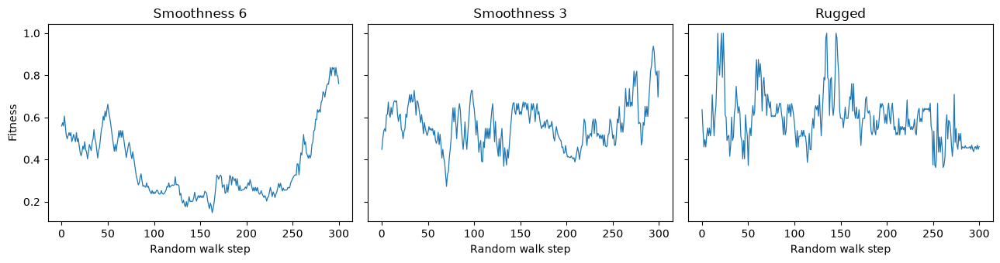
    


The more rugged the landscape, the less the fitness at one step tells us about the fitness at the next. The **autocorrelation** of the walk measures this: the correlation between the fitness values $f_1, \ldots, f_{T-s}$ and the values $f_{1+s}, \ldots, f_T$ that follow $s$ steps later,

$$\rho(s)=\frac{\sum_i(f_i-\bar{f})(f_{i+s}-\bar{f})}{\sqrt{\sum_i(f_i-\bar{f})^2\sum_i(f_{i+s}-\bar{f})^2}}.$$

A value close to 1 means that neighbours have similar fitness; a value close to 0 means that the fitness of a solution says nothing about its neighbours. (If the walk never changes fitness, the correlation is undefined.)


```python
def autocorrelation(trace, step_size=1):
    if not 0 < step_size < len(trace):
        raise ValueError("Lag must be between 1 and len(trace)-1")
    left, right = np.asarray(trace[:-step_size]), np.asarray(trace[step_size:])
    if np.std(left) == 0 or np.std(right) == 0:
        return float("nan")  # correlation of a constant sequence is undefined
    return float(np.corrcoef(left, right)[0, 1])
```

We now turn the smoothness dial further than in the gallery (where `Rugged` has smoothness 1). For every landscape we average the autocorrelation over ten walks, count the local optima, and check how often the hillclimber with restarts from above finds the global optimum:


```python
print("smoothness   autocorrelation   local optima   climbs finding the optimum")
for smoothness in [0.5, 1, 2, 3, 6]:
    grid = random_landscape(smoothness)
    correlation = np.mean([autocorrelation(grid_walk(grid)) for _ in range(10)])
    success = np.mean([restart_climb(grid, budget) for _ in range(runs)])
    print(f"{smoothness:10}   {correlation:15.2f}   {len(local_optima(grid)):12d}   {success:26.0%}")
```

    smoothness   autocorrelation   local optima   climbs finding the optimum
           0.5              0.27            265                           5%
             1              0.77             97                          34%
             2              0.93             27                          52%
             3              0.97             17                          66%


             6              0.98              4                          92%


The smoother the landscape, the closer its autocorrelation is to 1, the fewer local optima it has, and the more often hillclimbing finds the global optimum. To count local optima we need to know the whole landscape; for autocorrelation, a random walk is enough, so we can measure it on any problem. It indicates how hard a landscape is for local search, but it is no guarantee, as we will see below.

### Neutrality and information content

Autocorrelation is one of several measures computed from random walks. The ones in this section use a coarser view of the walk: for every step, they only record whether the fitness went up (`+`), down (`-`) or stayed the same (`0`). Changes of at most `epsilon` count as `0`; for now `epsilon = 0`, so every change counts. The measures describe **neutrality** (how much of the landscape is flat) and **information content** (how much the fitness tells us as we move).


```python
def get_fitness_string(trace, epsilon=0):
    return ''.join('+' if b-a > epsilon else '-' if a-b > epsilon else '0'
                   for a, b in zip(trace, trace[1:]))
```

To see what these symbols look like, we take short random walks on three landscapes from our gallery, and colour each step by its symbol: green for `+`, red for `-` and grey for `0`.


```python
colours = {"+": "tab:green", "-": "tab:red", "0": "darkgrey"}

def show_walk(trace, title):
    """A walk's fitness values, with every step coloured by its symbol."""
    for step, symbol in enumerate(get_fitness_string(trace)):
        plt.plot([step, step + 1], trace[step:step + 2], color=colours[symbol], linewidth=2)
    plt.title(title)
    plt.xlabel("Step of the walk")
```


```python
plt.figure(figsize=(15, 3.5))
for position, name in enumerate(["Smoothness 6", "Rugged", "Plateaus"], start=1):
    plt.subplot(1, 3, position)
    show_walk(grid_walk(gallery[name], steps=80), name)
plt.tight_layout()
```


    
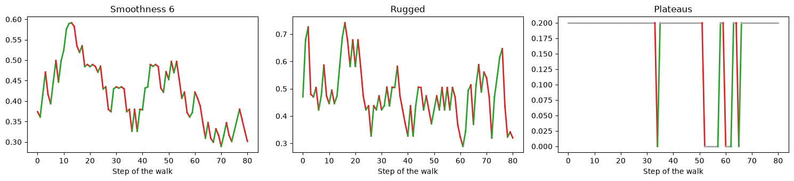
    


On the smooth landscape, neighbouring cells have similar fitness, so the walk changes gradually. On the rugged landscape, neighbours differ a lot and the walk jumps up and down. On the plateaus, most steps leave the fitness unchanged.

**Neutrality distance** (ND) is the length of the longest run of consecutive `0`s, divided by the number of steps of the walk.


```python
from itertools import groupby

def neutrality_distance(trace, epsilon=0):
    symbols = get_fitness_string(trace, epsilon)
    longest = max((sum(1 for _ in run) for symbol, run in groupby(symbols) if symbol == '0'), default=0)
    return longest / len(symbols) if symbols else 0
```

The **neutral fraction** (NF) is the share of `0`s among all steps: 1 for a walk that never changes fitness, 0 for a walk where every step does.


```python
def neutral_fraction(trace, epsilon=0):
    symbols = get_fitness_string(trace, epsilon)
    return symbols.count('0') / len(symbols) if symbols else 0
```

Both measures are easy to see if we draw the symbols of a longer walk as a strip of colours. The neutral fraction is the share of grey; the neutrality distance is the length of the longest grey stretch, outlined in black:


```python
import re
from matplotlib.colors import ListedColormap
from matplotlib.patches import Rectangle

def longest_neutral_run(symbols):
    """Start and length of the longest run of '0' symbols."""
    runs = re.finditer("0+", symbols)
    return max(((run.start(), len(run.group())) for run in runs), key=lambda r: r[1], default=(0, 0))

def show_strips(traces):
    """One row per walk: green +, red -, grey 0."""
    rows = [["-0+".index(s) for s in get_fitness_string(trace)] for trace in traces.values()]
    plt.imshow(rows, aspect="auto", interpolation="nearest", vmin=0, vmax=2,
               cmap=ListedColormap([colours["-"], colours["0"], colours["+"]]))
    plt.yticks(range(len(traces)), list(traces))
    plt.xlabel("Step of the walk")
```


```python
walks = {name: grid_walk(gallery[name], steps=200) for name in ["Smoothness 3", "Plateaus", "Needle in a haystack"]}
plt.figure(figsize=(13, 2.8))
show_strips(walks)
for row, trace in enumerate(walks.values()):
    start, length = longest_neutral_run(get_fitness_string(trace))
    plt.gca().add_patch(Rectangle((start - 0.5, row - 0.5), length, 1, fill=False, linewidth=2))
plt.yticks(range(len(walks)), [f"{name}\nNF = {neutral_fraction(trace):.2f}, ND = {neutrality_distance(trace):.2f}"
                               for name, trace in walks.items()])
```


    ([<matplotlib.axis.YTick at 0x111b64920>,
      <matplotlib.axis.YTick at 0x111d60c50>,
      <matplotlib.axis.YTick at 0x1123a5d60>],
     [Text(0, 0, 'Smoothness 3\nNF = 0.00, ND = 0.00'),
      Text(0, 1, 'Plateaus\nNF = 0.95, ND = 0.62'),
      Text(0, 2, 'Needle in a haystack\nNF = 1.00, ND = 1.00')])


    
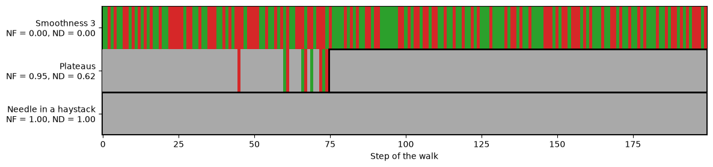
    


**Information content** (IC) looks at the `+`/`-`/`0` string and asks how often consecutive symbols differ. Writing $p_{pq}$ for the fraction of adjacent symbol pairs that are $p$ followed by $q$ (for $p \neq q$):

$$H(\epsilon) = -\sum_{p \neq q} p_{pq} \log_6 p_{pq}$$

The base of the logarithm, 6, is the number of ordered pairs of distinct symbols among `+`, `-`, `0`, which keeps IC between 0 and 1. A smooth landscape keeps moving the same way for a while, so consecutive symbols rarely differ and IC stays low; a rugged one flips direction constantly and pushes IC upward.


```python
from sbse_support import pair_entropy

def information_content(trace, epsilon=0):
    return pair_entropy(get_fitness_string(trace, epsilon))
```

**Partial information content** (PIC) is a more direct read on modality. Take the symbol string, delete every `0`, then delete every symbol that is the same as the one before it -- what survives is exactly the sequence of genuine direction reversals. PIC is the length of what survives divided by the length of the original string. A landscape that reverses direction at every step keeps everything, so PIC is 1; a landscape with no slope at all keeps nothing, so PIC is 0.


```python
def partial_information_content(trace, epsilon=0):
    symbols = get_fitness_string(trace, epsilon)
    non_zero = [symbol for symbol in symbols if symbol != '0']
    compressed = [symbol for i, symbol in enumerate(non_zero) if i == 0 or symbol != non_zero[i-1]]
    return len(compressed) / len(symbols) if symbols else 0
```

For example, for a short string of symbols:


```python
symbols = "++0++--0---+0++-"
non_zero = symbols.replace("0", "")
reversals = "".join(s for i, s in enumerate(non_zero) if i == 0 or s != non_zero[i - 1])
print(f"symbols:              {symbols}\nwithout 0:            {non_zero}\nwithout repetitions:  {reversals}")
print(f"PIC = {len(reversals)} / {len(symbols)} = {len(reversals) / len(symbols):.2f}")
```

    symbols:              ++0++--0---+0++-
    without 0:            ++++-----+++-
    without repetitions:  +-+-
    PIC = 4 / 16 = 0.25


Only four symbols survive: the walk went up, then down, then up, then down. A rugged landscape, where the direction changes at almost every step, keeps most of its symbols.

**Repeated-pair entropy** (RPE) looks at the pairs where the symbol repeats (`++`, `--` and `00`), and measures how evenly they are spread over these three kinds. With $q_p$ the share of repeated pairs of kind $p$,

$$RPE(\epsilon)=-\sum_p q_p\log_3 q_p.$$

A walk that never leaves a plateau has only `00` pairs, and RPE 0; an even mix of the three kinds gives RPE 1. RPE ignores how many repeated pairs there are, so read it together with the neutral fraction.


```python
def repeat_pair_entropy(trace, epsilon=0):
    # Entropy over the ++, -- and 00 pairs only
    return pair_entropy(get_fitness_string(trace, epsilon), same=True)
```

Information content and repeated-pair entropy both count pairs of consecutive symbols. We can show all nine kinds of pairs in a 3 x 3 grid: information content looks at the pairs where the symbol changes (off the diagonal), repeated-pair entropy at the pairs where it repeats (on the diagonal).


```python
def show_pairs(trace, title):
    """Share of each pair of consecutive symbols: rows are the first symbol, columns the second."""
    symbols, order = get_fitness_string(trace), "+-0"
    shares = np.zeros((3, 3))
    for a, b in zip(symbols, symbols[1:]):
        shares[order.index(a), order.index(b)] += 1 / (len(symbols) - 1)
    plt.imshow(shares, cmap="Blues", vmin=0, vmax=0.5)
    for (r, col), share in np.ndenumerate(shares):
        plt.text(col, r, f"{share:.2f}", ha="center", va="center")
    plt.xticks(range(3), list(order))
    plt.yticks(range(3), list(order))
    plt.title(f"{title}\nIC = {information_content(trace):.2f}, RPE = {repeat_pair_entropy(trace) + 0:.2f}")
```


```python
plt.figure(figsize=(13, 4))
for position, name in enumerate(["Smoothness 6", "Rugged", "Plateaus"], start=1):
    plt.subplot(1, 3, position)
    show_pairs(grid_walk(gallery[name], steps=1000), name)
plt.tight_layout()
```


    
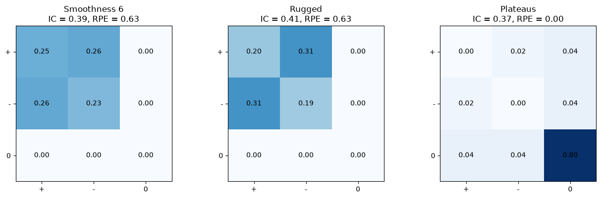
    


With `epsilon = 0`, the smooth and the rugged landscape give almost the same pairs: a random walk on a grid turns around at random, so it goes up and down even on a smooth hill. On the plateaus, almost all pairs are `00`, and repeated-pair entropy is zero.

The difference lies in how large the steps are. With `epsilon = 0`, every change counts, however small. Increasing `epsilon` treats small changes as neutral: on a smooth landscape, where neighbours differ only a little, the symbols soon turn into `0`s, while a rugged landscape keeps changing direction even at larger values of `epsilon`:


```python
epsilons = np.linspace(0, 0.16, 17)
for name in ["Smoothness 6", "Smoothness 3", "Rugged"]:
    traces = [grid_walk(gallery[name]) for _ in range(10)]
    plt.plot(epsilons, [np.mean([information_content(t, e) for t in traces]) for e in epsilons],
             marker="o", label=name)
plt.xlabel("epsilon")
plt.ylabel("Information content")
plt.legend()
```


    <matplotlib.legend.Legend at 0x111fe6cf0>


    
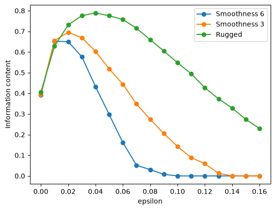
    


How quickly the information content falls as `epsilon` grows is therefore a better indicator of ruggedness than its value at `epsilon = 0`.

### The measures on the gallery

What do these numbers look like for the landscapes in our gallery? We take 20 random walks on each grid and average each measure over the walks:


```python
metrics = {"AC": autocorrelation, "ND": neutrality_distance, "NF": neutral_fraction,
           "IC": information_content, "PIC": partial_information_content,
           "RPE": repeat_pair_entropy}

def average(metric, traces):
    values = [v for v in map(metric, traces) if not np.isnan(v)]
    return np.mean(values) if values else float("nan")   # nan: undefined on every walk
```


```python
print(f"{'':22s}" + "".join(f"{name:>7s}" for name in metrics))
for name, grid in gallery.items():
    traces = [grid_walk(grid) for _ in range(20)]
    print(f"{name:22s}" + "".join(f"{average(metric, traces):7.2f}" for metric in metrics.values()))
```

                               AC     ND     NF     IC    PIC    RPE
    Smooth                   0.99   0.00   0.00   0.39   0.51   0.63
    Smoothness 6             0.98   0.00   0.00   0.39   0.52   0.63
    Smoothness 3             0.96   0.00   0.00   0.39   0.54   0.63


    Rugged                   0.79   0.00   0.00   0.41   0.62   0.63
    Plateaus                 0.93   0.11   0.88   0.35   0.10   0.00
    Deceptive                0.96   0.00   0.00   0.39   0.51   0.63


    Needle in a haystack    -0.01   0.90   1.00   0.01   0.00   0.00
    Two funnels              0.98   0.00   0.00   0.39   0.52   0.63


Autocorrelation falls as the landscape gets more rugged, and partial information content rises. The neutral fraction and neutrality distance pick out the plateaus and the needle. But the deceptive landscape and the two funnels look just like the smooth hill: a random walk almost never visits the narrow peak or moves from one funnel to the other, so measures based on random walks cannot see this kind of global structure. (For the needle, autocorrelation is only defined on the few walks that happen to step onto it.)

### Fitness-distance correlation

A random walk only sees the landscape locally. If we know where the global optimum is, we can ask a global question instead: do solutions closer to the optimum have higher fitness? The **fitness-distance correlation** (FDC) is the correlation between the fitness of a solution and its distance to the nearest global optimum. On our grids, the distance is the number of steps between two cells:


```python
def fitness_distance_correlation(grid):
    """Correlation between fitness and the number of steps to the nearest global optimum."""
    tops = np.argwhere(grid == grid.max())
    distances = [[min(abs(r - a) + abs(c - b) for a, b in tops) for c in range(grid_size)]
                 for r in range(grid_size)]
    return float(np.corrcoef(np.ravel(distances), grid.ravel())[0, 1])
```


```python
fdc = {name: fitness_distance_correlation(grid) for name, grid in gallery.items()}
plt.figure(figsize=(8, 4))
plt.barh(list(fdc)[::-1], list(fdc.values())[::-1])
plt.axvline(0, color="black", linewidth=0.8)
plt.xlim(-1, 1)
plt.xlabel("Fitness-distance correlation")
plt.tight_layout()
```


    
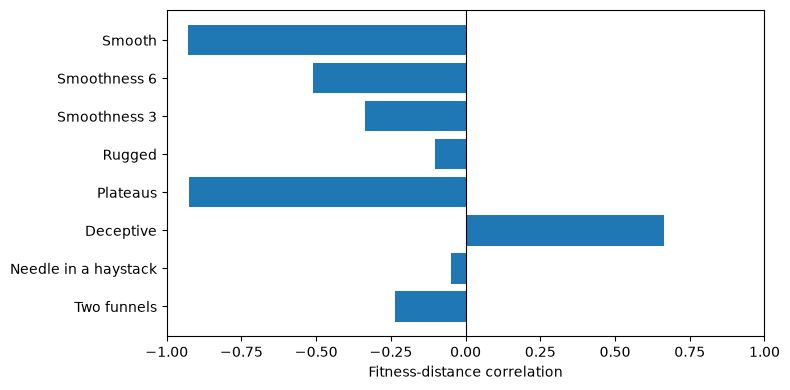
    


On the smooth hill, fitness rises steadily towards the optimum, and FDC is close to -1. The more rugged the landscape, the closer FDC gets to 0, and for the needle, fitness says nothing about where the optimum is. For the two funnels, FDC is only weakly negative, because half of the landscape leads to the wrong funnel. The deceptive landscape is the only one with a positive FDC: fitness leads away from the optimum, which the random-walk measures could not see. FDC misses other things, though: the plateaus get the same value as the smooth hill, because fitness does rise towards the optimum, just not from one cell to the next.

FDC requires knowing where the optima are. It is therefore a tool for understanding benchmark problems, or why a search failed, rather than for problems we have not yet solved.

### One max and compiler flags

Finally, we apply these measures to two landscapes from Part 1, one max and the compiler flags. Their solutions are bit strings, so a random walk flips one random bit at every step. We take 200 walks on each landscape:


```python
def walk_trace(fitness, N, steps=2000):
    """A random walk over bit strings of length N that records the fitness at every step."""
    current = [random.choice([0, 1]) for _ in range(N)]
    trace = [fitness(current)]
    for _ in range(steps):
        position = random.randint(0, N - 1)
        current = current[:]
        current[position] = 1 - current[position]
        trace.append(fitness(current))
    return trace


def onemax_fitness(bits):
    return sum(bits)

def flags_fitness(bits):
    return -sizes[tuple(bits)]

walks = 200
onemax_traces = [walk_trace(onemax_fitness, 20, steps=500) for _ in range(walks)]
flags_traces = [walk_trace(flags_fitness, 8, steps=500) for _ in range(walks)]
```


```python
fig, axes = plt.subplots(1, len(metrics), figsize=(16, 3.5))
for ax, (name, metric) in zip(axes, metrics.items()):
    onemax_scores = [metric(trace) for trace in onemax_traces]
    flags_scores = [metric(trace) for trace in flags_traces]
    ax.boxplot([onemax_scores, flags_scores])
    ax.set_xticks([1, 2], ["One Max", "Compiler Flags"])
    ax.set_title(name)
plt.tight_layout()
```


    
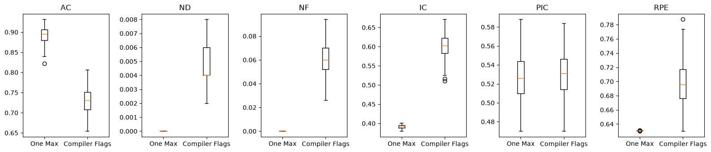
    


The compiler-flag landscape is more rugged than one max: its autocorrelation is lower and its information content higher. One max has no neutrality at all, since every bit flip changes the fitness by exactly one. For the compiler flags, some flips leave the program size unchanged, which gives a small neutral fraction.

The compiler-flag landscape has only 256 configurations, so we can draw all of it. We arrange them on a 16 x 16 grid such that neighbouring cells differ in exactly one bit, using a _Gray code_ ordering: the first four flags choose the row, the last four the column. The grid can only show 4 of each configuration's 8 neighbours, but the dots mark local optima with respect to all 8:


```python
gray = [i ^ (i >> 1) for i in range(16)]      # consecutive entries differ in exactly one bit

def four_bits(value):
    return [(value >> shift) & 1 for shift in (3, 2, 1, 0)]

def show_bit_landscape(fitness, title):
    """All 8-bit strings: the first four bits choose the row, the last four the column."""
    solutions = [[four_bits(gray[r]) + four_bits(gray[c]) for c in range(16)] for r in range(16)]
    grid = np.array([[fitness(s) for s in row] for row in solutions])
    plt.imshow(grid, cmap="viridis", origin="lower", interpolation="nearest")
    optima = 0
    for r, row in enumerate(solutions):
        for c, s in enumerate(row):
            strict = all(fitness(n) < grid[r, c] for n in bit_neighbours(s))
            optima += strict
            if strict or grid[r, c] == grid.max():      # the global optimum is marked even on a plateau
                plt.plot(c, r, "o", markersize=6, markeredgecolor="black",
                         color="red" if grid[r, c] == grid.max() else "white")
    plt.title(f"{title}\n{optima} local optim{'um' if optima == 1 else 'a'}")
    plt.xticks([])
    plt.yticks([])
```


```python
show_bit_landscape(lambda flags: worst_size - sizes[tuple(flags)], "Compiler flags")
```


    
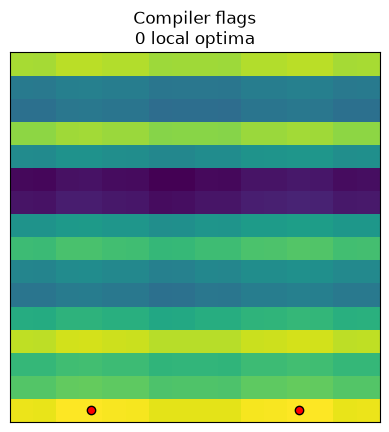
    


The colour changes mostly from row to row, and hardly from column to column: the first four flags, which choose the row, change the program size by hundreds or thousands of bytes, the last four by at most about 150. Most of the landscape's structure comes from a few of its dimensions.

Since we know all 256 configurations, we can also compute the fitness-distance correlation exactly. The distance is now the Hamming distance, the number of flags that differ, to the nearest of the best configurations. The points are moved a little to the left or right at random so that they do not hide each other:


```python
best_size = min(sizes.values())
best_configs = [config for config, value in sizes.items() if value == best_size]
fdc_distances = [min(sum(a != b for a, b in zip(config, optimum)) for optimum in best_configs) for config in sizes]
fdc_fitness = [worst_size - sizes[config] for config in sizes]
fdc_jitter = [d + random.uniform(-0.15, 0.15) for d in fdc_distances]

fdc_correlation = float(np.corrcoef(fdc_distances, fdc_fitness)[0, 1])

plt.scatter(fdc_jitter, fdc_fitness, alpha=0.6, s=20)
plt.xlabel("Hamming distance to nearest optimal configuration")
plt.ylabel("Fitness (bytes saved vs. worst configuration)")
plt.title(f"Fitness-distance correlation (r = {fdc_correlation:.2f})")
```


    Text(0.5, 1.0, 'Fitness-distance correlation (r = -0.69)')


    
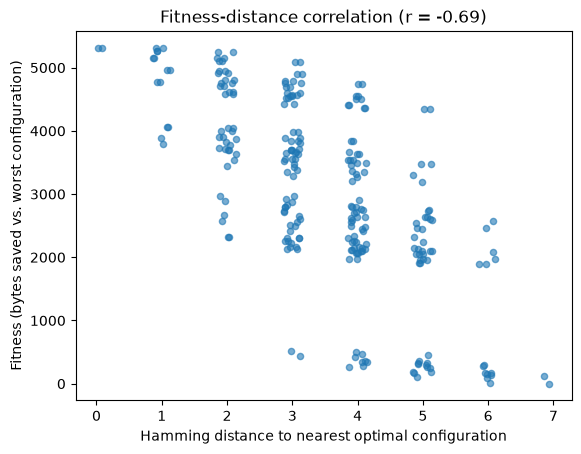
    


With r = -0.69, configurations that are closer to a best configuration tend to produce smaller programs: on the whole, the landscape guides a search towards the optimum.

## From Local to Global Search

All the local search algorithms we have seen only ever move to a neighbour. To finish, here is a landscape where that is not enough. The _jump_ function is one max with a gap: just before the optimum, fitness drops.


```python
def jump(bits, gap=3):
    """One max, except for a gap of width `gap` just before the optimum."""
    ones, length = sum(bits), len(bits)
    if ones <= length - gap or ones == length:
        return ones
    return length - ones
```

Since the fitness only depends on the number of ones, we can plot it against the number of ones:


```python
jump_length = 20
ones = range(jump_length + 1)
plt.plot(ones, [jump([1] * k + [0] * (jump_length - k)) for k in ones], marker="o", label="Jump")
plt.plot(ones, ones, linestyle=":", color="grey", label="One max")
plt.xlabel("Number of ones")
plt.ylabel("Fitness")
plt.legend()
```


    <matplotlib.legend.Legend at 0x112456cf0>


    
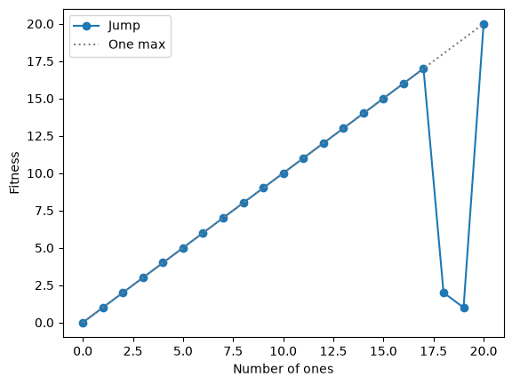
    


With eight bits we can draw the whole landscape. Every string just before the gap is a local optimum:


```python
show_bit_landscape(lambda bits: jump(bits, gap=2), "Jump, 8 bits, gap 2")
```


    
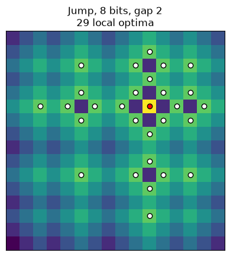
    


### Measuring the jump landscape

How does this landscape look to the measures from this chapter? We compare it with one max on 20 bits: random-walk statistics, the fitness-distance correlation for random solutions, and how many hillclimbs from random starting points reach the optimum.


```python
def landscape_summary(fitness, length, samples=1000, climbs=100):
    traces = [walk_trace(fitness, length, steps=1000) for _ in range(20)]
    summary = {name: average(metric, traces) for name, metric in metrics.items()}
    solutions = [[random.randint(0, 1) for _ in range(length)] for _ in range(samples)]
    distances = [length - sum(s) for s in solutions]          # bits to flip to reach all ones
    summary["FDC"] = float(np.corrcoef(distances, [fitness(s) for s in solutions])[0, 1])
    ends = [hillclimbing([random.randint(0, 1) for _ in range(length)], fitness, bit_neighbours,
                         budget=math.inf)[0] for _ in range(climbs)]
    summary["Climbs"] = np.mean([fitness(end) == length for end in ends])
    return summary
```


```python
rows = {"One max": landscape_summary(onemax_fitness, jump_length),
        "Jump": landscape_summary(jump, jump_length)}
print(f"{'':10s}" + "".join(f"{name:>8s}" for name in rows["Jump"]))
for name, summary in rows.items():
    print(f"{name:10s}" + "".join(f"{value:8.2f}" for value in summary.values()))
```

                    AC      ND      NF      IC     PIC     RPE     FDC  Climbs
    One max       0.90    0.00    0.00    0.39    0.52    0.63   -1.00    1.00
    Jump          0.89    0.00    0.00    0.39    0.53    0.63   -1.00    0.00


By every measure, the jump landscape looks just like one max: random walks and random samples almost never reach a string with 18 or more ones, which is where the gap is. Yet not a single climb reaches the optimum. As with the deceptive landscape in our gallery, what makes the problem hard is a small part of the landscape that measures based on random samples do not see.

### Bigger steps

The hillclimber fails because its neighbourhood only ever flips one bit, and crossing the gap needs three bits flipped at once. Restarts do not help: every climb ends at the edge of the gap. Random search can reach any solution, but it ignores fitness, and there are over a million solutions. What we need is a search that mostly takes small steps, but occasionally a bigger one. One way to do this is to flip every bit with probability 1/n:


```python
from collections import Counter

def mutate(bits):
    """Flip every bit with probability 1/n."""
    return [1 - b if random.random() < 1 / len(bits) else b for b in bits]

flipped = Counter(sum(a != b for a, b in zip(bits, mutate(bits)))
                  for bits in ([0] * jump_length for _ in range(10000)))
print({k: f"{flipped[k] / 10000:.0%}" for k in sorted(flipped)})
```

    {0: '37%', 1: '37%', 2: '19%', 3: '6%', 4: '1%', 5: '0%', 6: '0%'}


Most of the time it flips no bit or a single bit, just like a local step, but about a quarter of the time it flips two or more. Since every solution can be reached in a single step, this is a _global_ search operator. Using it in place of the neighbourhood gives the simplest possible global search: keep the mutated solution if it is at least as good.


```python
def climb_with_restarts(fitness, length, budget):
    used = 0
    while used < budget:
        start = [random.randint(0, 1) for _ in range(length)]
        best, history = hillclimbing(start, fitness, bit_neighbours, budget=budget - used)
        used += len(history)
        if fitness(best) == length:
            return True
    return False

def random_sampling(fitness, length, budget):
    return any(fitness([random.randint(0, 1) for _ in range(length)]) == length for _ in range(budget))

def mutation_search(fitness, length, budget):
    current = [random.randint(0, 1) for _ in range(length)]
    score = fitness(current)
    for _ in range(budget - 1):
        candidate = mutate(current)
        if (candidate_score := fitness(candidate)) >= score:
            current, score = candidate, candidate_score
        if score == length:
            return True
    return False
```


```python
budget, runs = 20000, 50
searches = {"Hillclimbing with restarts": climb_with_restarts,
            "Random search": random_sampling,
            "Mutation with rate 1/n": mutation_search}
found = {name: np.mean([search(jump, jump_length, budget) for _ in range(runs)]) for name, search in searches.items()}
plt.figure(figsize=(8, 3))
plt.barh(list(found)[::-1], list(found.values())[::-1])
plt.xlabel(f"Runs finding the optimum ({budget} evaluations, {runs} runs)")
plt.xlim(0, 1)
plt.tight_layout()
```


    
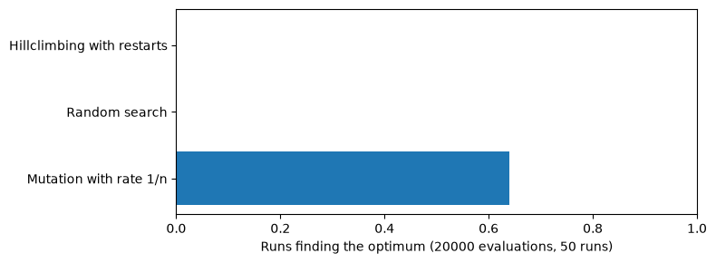
    


Only the search with bigger steps reliably finds the optimum. It is still mostly local -- the larger the gap, the longer it has to wait for a lucky mutation -- but it can no longer get stuck for good. This search, keeping one solution and replacing it by a mutated copy whenever that is at least as good, is called the (1+1) evolutionary algorithm. It is where the next chapter starts: _evolutionary algorithms_ build on exactly this idea of global search.
